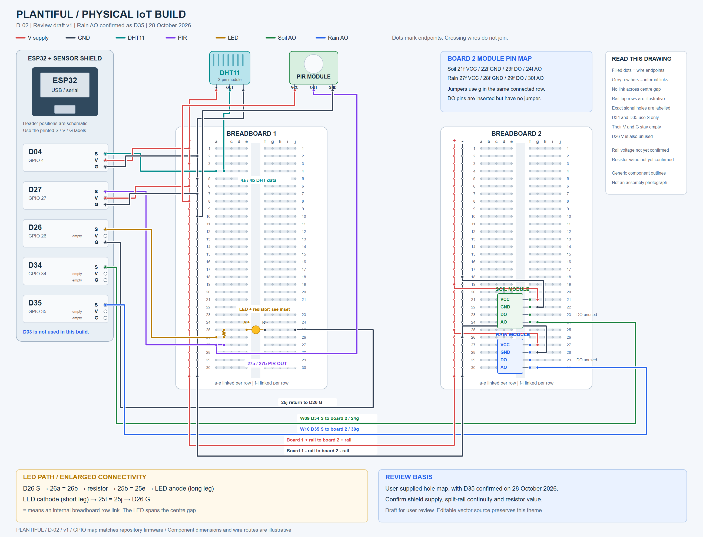

# Plantiful documentation

This is the single documentation index for Plantiful. It replaces the separate README files that previously sat in each subfolder. Use the sections below to find plans, reports, verification records, security material and figure instructions.

## Document map

| Area | What it contains | Start here |
|---|---|---|
| Sprint 2 | Active audit, backlog, testing plan, diagrams and sign-off preparation for 6 November 2026 | [Sprint 2](#sprint-2) |
| Sprint 1 | Revised Sprint 1 markdown and draft figure sources. Not the submitted PDF | [Sprint 1](#sprint-1) |
| Security | Local-only plan, assessment report, findings register and evidence guide | [Security](#security-and-data-protection) |
| Diagrams | D-02 physical IoT wiring image and editable source | [D-02 physical build](#d-02-physical-build) |
| Testing | Historical prototype verification and pending integrated trials | [Testing, design and guides](#testing-design-and-guides) |
| Guides | Deployment and maintenance runbook | [Testing, design and guides](#testing-design-and-guides) |
| Design | Optional assisted identification proposal, not a completed feature | [Testing, design and guides](#testing-design-and-guides) |
| Assets | Shared logo and existing architecture, ERD and sequence images | [Shared assets](#shared-assets) |
| Templates | Reusable blank templates, not delivery evidence | [Templates](#templates) |
| Rubric | Assessment reference. Sprint 2 product target is 36/40 | [Marking rubric](Marking_Rubric.md) |
| Proposal | System proposal and requirements baseline | [System proposal](Reports/System_Proposal_Report.md) |

## Sprint 2

[GitHub Sprint 2 tracker #42](https://github.com/Basilagas21/COS30049_InnovationProject_Plantiful/issues/42) links all 19 work packages. The local files below hold the detailed content.

### Delivery brief

| Field | Current position |
|---|---|
| Submission | 6 November 2026, exact time to be confirmed |
| Internal completion | 5 November 2026 |
| Product target | At least 36/40, equivalent to 90% |
| Tutor direction | Final implementation, enhancements, integration, testing, bug fixing, refinement and demonstration readiness |
| Sign-off | Sprint 1 completed. Sprint 2 meeting pending |
| Presentation | Approximately 10 to 20 minutes including questions, exact split unconfirmed |
| Report length | No page limit confirmed |

### Reading order

| File | Purpose |
|---|---|
| [01 Baseline audit](Reports/Sprint2/01_Baseline_Audit.md) | Dated repository and GitHub findings, executed local checks and initial delivery recommendations |
| [02 Execution backlog](Reports/Sprint2/02_Execution_Backlog.md) | Authoritative current work status, priorities, dependencies, optional enhancements and schedule |
| [03 Testing and evidence plan](Reports/Sprint2/03_Testing_and_Evidence_Plan.md) | Definition of Done, procedures, environment record, usability sessions and result templates |
| [04 Diagrams and hardware plan](Reports/Sprint2/04_Diagrams_and_Hardware_Plan.md) | Figure specifications, actual breadboard mapping, open hardware questions and illustration quality checks |
| [05 Report and sign-off plan](Reports/Sprint2/05_Report_and_Signoff_Plan.md) | Rubric mapping, writing structure, meeting preparation, demonstration and final submission checks |

The planning files are not the final Sprint 2 report. Create `Sprint_Report_2.md` in `Reports/Sprint2/` when drafting begins, using document 05. Do not add empty test results or invented participant observations.

### What is complete

The 27 October baseline review and local checks are recorded in document 01. Both application typechecks passed. Mobile lint passed. Web lint had one existing image warning and the web production build passed. The existing unit suites passed 12 tests in total. Fresh dependency audits identified remediation work. A malformed IoT payload was reproduced against a fake client. The web tree was moved to Next.js 16.4.3 and returned zero recorded production advisories. Mobile moved to Expo SDK 58 and the user confirmed the app opens in Expo Go on 28 October.

These checks do not establish physical integration, current live permissions, participant outcomes or complete coverage. No remediation is marked complete merely because it appears in the plan.

### Maintaining this workspace

Update document 02 when work starts, is blocked, or has been verified. Use the same `S2-` finding IDs, test IDs and `D-` figure IDs across the files. Record a dated result before marking an item Verified. Keep the audit as a historical snapshot.

## Sprint 1

| Document | Status |
|---|---|
| [Sprint 1 revised report](Reports/Sprint1/Sprint_Report_1.md) | Revised markdown with figure placeholders. Not the exact submitted PDF |
| [Figure sources](Reports/Sprint1/diagrams/FIGURES.md) | Draft Mermaid material and illustration guidance for the revised report |

The submitted PDF remains at `Basilagas21/Docs and templates/sprint1.pdf`. Sprint 1 sign-off was completed according to the team.

These files retain the Sprint 1 content. Their claims and figure logic need checking before reuse in Sprint 2. In particular, the draft timeline uses indicative dates and the alert diagram needs to show independent rule checks.

## Security and data protection

Security pack for Plantiful, Group 7, COS30049. It covers the cybersecurity and data protection block in the project scope and the application security aspect.

`Security/` is excluded from version control. It holds internal assessment material and raw scan output. Share copies only with the teaching team and team members. Never commit credentials, session cookies, participant details or sensitive plant locations. Links in this section therefore resolve locally only.

### Security scope coverage

| Scope requirement | How Plantiful addresses it | Document | Primary evidence | Status |
|---|---|---|---|---|
| Secure login for all users | Supabase Auth with server-side password hashing, email confirmation and JWT sessions. The web app stores the session in HttpOnly cookies through `@supabase/ssr`. The mobile app stores the session in AsyncStorage with auto-refresh | Plan 4.2, Report 3.1 and 3.3, Report 5.4 | Auth code review and MASVS L1 check | Implemented |
| Encryption for personal data, performance records and assessments | TLS 1.2 or later in transit. Platform-managed encryption at rest. Access limited by row-level security. No column-level encryption, because the classification is limited personal data | Report 3.4 | Control table in Report 3.4 | Implemented, with a documented decision against field-level encryption |
| Access control for admins, trainers and guides | Four roles, namely anon, botanist, conservation officer and admin. The officer role is the reviewer role described in the scope. The botanist role is the field contributor role. Controls are enforced in the database | Report 3.2, Appendix A, Appendix B | Policy matrices and RLS verification output | Implemented |
| Outcome of protected information and maintained trust | The public portal shows approved and published content only. The reports bucket is private. Approval actions are audited. No client holds the service role key | Report 3.3, 5.3 and 5.5 | RLS output and ZAP output | Implemented |
| Simple authentication on all platforms | One Supabase account works on web and mobile. Session refresh is enabled. There is no second credential store | Report 3.3 and 5.4 | Code review | Implemented |
| Secure access controls and encryption on all platforms | The same database policies cover web, mobile and the IoT ingest path. Transport is HTTPS | Report 3.3 and Appendix A | RLS output | Implemented |
| SSDLC planning and execution | Security activities are assigned to phases, with gates, owners and deliverables | Plan 2 and 9 | Security plan | Executed in Sprint 1, refreshed for Sprint 2 |
| Vulnerability assessment details, including tools and scope | The assessment strategy, toolset, environments and exit criteria are defined before execution | Plan 5 to 8 | Security plan | Defined |
| Assessment results with verified vulnerabilities | Findings are recorded with reproduction, remediation and a dated re-test | Register 2, 5 and 6, Report 5 to 7 | Evidence folder | Verified to 10 October 2026, Sprint 2 re-test open |
| Recommendations and their implementation | Ten recommendations carry an owner, target and status | Register 4 | Register | Partly implemented, remainder scheduled or deferred |

### Security document map

| Document | Purpose | Use it when |
|---|---|---|
| [Security plan](Security/01_Security_Plan.md) | SSDLC activities, scope, tools, environments, test cases, gates and owners | You need to know how security work is planned and judged |
| [Assessment report](Security/02_Assessment_Report.md) | Full narrative assessment, architecture, tests, findings and appendices | You need detail behind a finding or control |
| [Findings register](Security/03_Findings_Register.md) | Single tracker for findings, recommendations, residual risk and re-tests | You need current status or ownership |
| [Evidence guide](Security/04_Evidence_Guide.md) | Collection, naming, redaction, indexing and submission rules | You are capturing or packaging evidence |
| [Evidence folder](Security/Evidence/) | Raw historical output retained locally | You are verifying a specific past result |

### Security status

Status as at 27 October 2026.

| Measure | Result |
|---|---|
| Findings raised | 12 |
| Findings fixed | 11 |
| Findings with mitigation defined | 1, F-06 mobile toolchain advisories |
| Confirmed critical or high findings in application code | 0 at the 10 October 2026 close |
| High ZAP alerts after remediation | 0 |
| Web production dependency advisories | 0 after the Next.js 16.4.3 upgrade on 27 October 2026 |
| Mobile production dependency advisories | 4, all in build and development tooling |
| Open Sprint 2 security work | S2-01 mobile toolchain acceptance, S2-02 credential and account remediation, S2-14 recommendation close-out, SEC-01 to SEC-03 |

The 10 October 2026 dependency figures are historical. A re-audit on 27 October 2026 found one critical and three high advisories in the web tree and one critical and three high advisories in the mobile tree. The web tree was then remediated to 0 entries. The mobile tree remains at 4 toolchain entries with no compatible automatic fix. The details and the remediation path are in Register 5.

### Security evidence

Raw output is retained locally in `Security/Evidence/`. The folder is excluded from version control. Read the [evidence guide](Security/04_Evidence_Guide.md) before adding files.

| Folder | Content |
|---|---|
| `Security/Evidence/checks/` | SQL verdicts, header captures and request or response checks from the 10 October 2026 assessment |
| `Security/Evidence/zap/` | OWASP ZAP HTML reports, alert JSON and the scan summary |
| `Security/Evidence/sprint2/` | New captures for the Sprint 2 re-test |

Evidence rules are cumulative. Never overwrite a historical file, add a dated file instead. Name files with the test identifier, the date and a short description. Keep originals unmodified and redact copies. Do not store passwords, cookies, tokens, keys or personal data. Add each file to the index below.

| Evidence ID | Claim or test | Date and version | File | Redaction |
|---|---|---|---|---|
| S2-AUD-WEB-01 | Web production dependency audit after the Next.js 16.4.3 upgrade | 27 October 2026, npm audit | `Security/Evidence/sprint2/audit-web-2026-10-27.json` | None. Audit metadata only |
| S2-AUD-MOB-01 | Mobile production dependency audit after the Expo SDK 58 upgrade | 27 October 2026, npm audit | `Security/Evidence/sprint2/audit-mobile-2026-10-27.json` | None. Audit metadata only |

### Security review rules

1. Update the register after every re-test, not the original report.
2. Keep original tool output. Add a new dated file instead of editing a capture.
3. Record date, tester, version, target, command, role and observed result.
4. Re-run the RLS verification script after every migration that changes policies.
5. Move a recommendation to done only when its verification is recorded.
6. Re-check dependency counts after any lockfile change.

### Security ownership

| Area | Owner | Responsibility |
|---|---|---|
| Security plan and report | Ashley Wallen Anak Winston | Plan, report assembly, submission packaging |
| Web controls and headers | Badrul Aliff Aiman bin Badrulmunirzaki | Web code, CSP, route handling, ZAP reruns |
| Mobile controls and store | Basill Agas Anak Heatley Rogers | Offline store, session handling, mobile checks |
| Database, RLS and storage | Muhammad Maqeel bin Muhammad Kahfi | Policies, triggers, RLS verification |
| IoT ingest surface | Gae Jayden MWINE | Ingest validation and sensor data rules |
| Dependency and credential remediation | Nathan Sebastian Learmonth | Audit triage, version changes, rotation record |
| Final approval | Group 7 | Sign-off on residual risk and submission |

## Diagrams

The D-02 physical wiring review draft was generated on 28 October 2026. Its image, editable source and online editing instructions are below. Other figure specifications remain in the [diagrams and hardware plan](Reports/Sprint2/04_Diagrams_and_Hardware_Plan.md).

### D-02 physical build

The drawing follows the user's breadboard map. On 28 October 2026 the user confirmed rain AO connects to D35 S. This supersedes the D33 entry in the earlier shield table and matches GPIO 35 in the repository firmware.

The image is a coordinate-based physical wiring illustration. Header spacing, component outlines and wire routing are illustrative. The exact shield model and module dimensions were not supplied. It is not a photograph or an electrical simulation.

| File | Purpose |
|---|---|
| [PNG image](Reports/Sprint2/diagrams/exported/D-02_physical_build.png) | View the review draft without a diagram editor |
| [SVG image](Reports/Sprint2/diagrams/exported/D-02_physical_build.svg) | Zoomable vector image for review and report export |
| [Editable diagrams.net file](Reports/Sprint2/diagrams/source/D-02_physical_build.drawio) | Edit shapes, labels and wire paths online |
| [Python source](Reports/Sprint2/diagrams/source/D-02_physical_build.py) | Rebuild the SVG and diagrams.net file in the same style |
| [Connection manifest](Reports/Sprint2/diagrams/source/D-02_connections.json) | Inspect the 22 jumper connections and component pin coordinates |



### Open and edit online

1. Open [diagrams.net](https://app.diagrams.net/).
2. Select Device if asked where to save diagrams.
3. Choose File, Open From, Device and select `Reports/Sprint2/diagrams/source/D-02_physical_build.drawio`.
4. Use the zoom control to inspect the breadboard holes. Wires, labels, boards and components are editable vector objects.
5. Save a copy after changes. Use File, Export as, PNG or SVG to produce a revised image.

For a paste-based workflow, open a blank diagram and choose Extras, Edit Diagram. Paste the `mxGraphModel` element from inside the `.drawio` file and replace the current drawing. Opening the file is simpler because it includes the page settings.

This workflow supports the exact supplied shield and breadboard layout without substituting a different sensor model. The editor does not validate voltages or simulate firmware.

### Reading the connections

- Red is the common positive supply. Its voltage is not yet confirmed.
- Slate is ground. The two negative rails share ground through their jumper.
- Teal, purple, amber, green and blue identify DHT11 data, PIR signal, LED signal, soil AO and rain AO.
- A filled dot marks a jumper endpoint. An insulated crossing is not a junction.
- Grey bars show internal five-hole connections. Each a-to-e group is separate from f-to-j across the centre gap.
- Rail attachment heights are illustrative where the supplied map specifies only the rail. Continuity across any split rail needs physical confirmation.
- Soil and rain DO pins occupy their stated f holes but have no jumper to the shield or power rails.
- D34 and D35 V/G pins remain empty. D26 V is unused.

The LED path is shown separately at the bottom of the image. Its resistor connects 26b to 25b. The anode is at 25e and the cathode at 25f. The LED therefore crosses the centre gap and the return leaves 25j for D26 G.

### Revisions without a style change

Keep the canvas size, component positions, palette and text hierarchy unless the user asks for a layout change. Identify corrections by endpoint, such as `W10, D35 S to board 2 30g`, rather than describing a wire only by colour.

The Python file is the canonical generated source. Change its endpoint definitions or component coordinates, regenerate both vector files, and then regenerate the PNG. A manual edit made only in diagrams.net will not automatically update the Python source and will be overwritten by regeneration. Preserve that edited file and reconcile its changes into the generator first.

Run from the repository root with Python 3.

```powershell
python -B "Docs/Reports/Sprint2/diagrams/source/D-02_physical_build.py"
```

The generator checks all 22 jumper pairs, signal continuity through the breadboard rows, power/ground separation, the three separate LED series nodes and unused DO rows. It writes SVG, diagrams.net XML and the connection manifest. These are drawing checks, not measurements of the installed hardware.

The PNG was rendered from the SVG using headless Chrome at 2600 by 1990 pixels. After a source change, export a new PNG from diagrams.net or render the SVG again. Do not keep an old raster alongside revised vector files.

Pending review items are the physical connections, component orientation, shield model, rail voltage, resistor value, sensor/module models and an assembly photo. Record corrections and approval in [issue #58](https://github.com/Basilagas21/COS30049_InnovationProject_Plantiful/issues/58). Draft generation does not close the hardware confirmation task in [#49](https://github.com/Basilagas21/COS30049_InnovationProject_Plantiful/issues/49).

## Testing, design and guides

| Document | Purpose and status |
|---|---|
| [Prototype verification](Testing/Prototype_Verification.md) | Checks recorded on 16 October and pending integrated mobile, sync and usability trials |
| [Deployment and maintenance](Guides/Prototype_Deployment_and_Maintenance.md) | Existing prototype runbook. Validate against the final release |
| [Optional innovation workflow](Design/Innovation_Workflow.md) | Proposed assisted identification workflow, not a completed feature |

The verification document is not proof that later builds behave the same way. Repeat device and database checks against the identified release candidate. Use `Security/04_Evidence_Guide.md` and the [security plan](Security/01_Security_Plan.md) for the final ZAP, RLS and storage tests.

## Shared assets

| Asset | Purpose |
|---|---|
| `Assets/plantiful_logo.png` | Shared project logo |
| `Assets/System_Architecture.png` | Existing architecture image referenced by the root README |
| `Assets/System Architecture.jpg` | Separate architecture image variant retained for review |
| `Assets/ER_diagram.jpg` | Existing ERD image |
| `Assets/UML_Sequence_Botanist.png` | Existing botanist sequence illustration |
| `Assets/UML_Sequence_ConservationOfficer.png` | Existing officer sequence illustration |
| `Assets/UML_Sequence_Admin.png` | Existing administrator sequence illustration |

These images are existing design assets, not newly verified Sprint 2 diagrams. Compare them with the current implementation before using them in the final report. Keep new Sprint 2 figure sources and exports with the Sprint 2 workspace.

## Templates

| Template | Markdown | Word |
|---|---|---|
| Product backlog | [Markdown template](Templates/01_R_Product_Backlog_Template.md) | [Word template](Templates/01_R_Product_Backlog_Template.docx) |
| Project proposal | [Markdown template](Templates/COS30029%20Complete%20Project_Proposal_Template.md) | [Word template](Templates/COS30029%20Complete%20Project_Proposal_Template.docx) |

These are reusable starting documents. They do not record completed implementation or test results. The COS30029 filename is retained from the supplied template. Use the actual COS30049 project details in submission documents.

## Filing conventions

Use `Reports/Sprint2/` for Sprint 2 planning and delivery records. Keep shared project reports in `Reports/`. Put operational instructions in `Guides/`, cross-sprint verification records in `Testing/`, and design proposals in `Design/`.

Keep one authoritative execution backlog. The baseline audit records historical observations and should not be silently rewritten to appear as a later test run.

Evidence and diagrams have different purposes. A diagram explains a design. A recorded test establishes an observed outcome. Link both to requirements where appropriate.

Raw security material remains local under `Security/`, which is gitignored. Redact and package selected evidence explicitly for submission. Do not assume the marker can access a local path.

Keep editable diagram sources with their owning sprint. Use `Assets/` for shared images. Retain existing image variants until their content and usage have been reviewed.

## Housekeeping record

The following paths were reorganised on 27 October 2026. The per-folder README files were consolidated into this single index on 28 October 2026.

| Previous path under Docs | Current path under Docs |
|---|---|
| `Innovation_Workflow.md` | `Design/Innovation_Workflow.md` |
| `Prototype_Deployment_and_Maintenance.md` | `Guides/Prototype_Deployment_and_Maintenance.md` |
| `Prototype_Verification.md` | `Testing/Prototype_Verification.md` |
| `Reports/Sprint_Report 1.md` | `Reports/Sprint1/Sprint_Report_1.md` |
| `Reports/diagrams/FIGURES.md` | `Reports/Sprint1/diagrams/FIGURES.md` |
| `Reports/Sprint_2_Baseline_and_Delivery_Plan.md` | `Reports/Sprint2/01_Baseline_Audit.md` |
| `Reports/Security_Assessment_Report.md` | `Security/02_Assessment_Report.md` |
| `Reports/SECURITY_EVIDENCE_README.md` | `Security/04_Evidence_Guide.md` |
| `Reports/evidence/` | `Security/Evidence/` |
| `Assets/README.md` | `README.md`, Shared assets |
| `Reports/README.md` | `README.md`, Sprint 1 and Sprint 2 sections |
| `Reports/Sprint1/README.md` | `README.md`, Sprint 1 |
| `Reports/Sprint2/README.md` | `README.md`, Sprint 2 |
| `Reports/Sprint2/diagrams/README.md` | `README.md`, D-02 physical build |
| `Security/README.md` | `README.md`, Security and data protection |
| `Security/Evidence/README.md` | `README.md`, Security evidence |
| `Templates/README.md` | `README.md`, Templates |

Existing GitHub issue text and past submissions may still cite the old paths. Use this table to locate them. Repository navigation links have been updated. The shared proposal keeps its location. The security material now lives in the local-only security pack.
