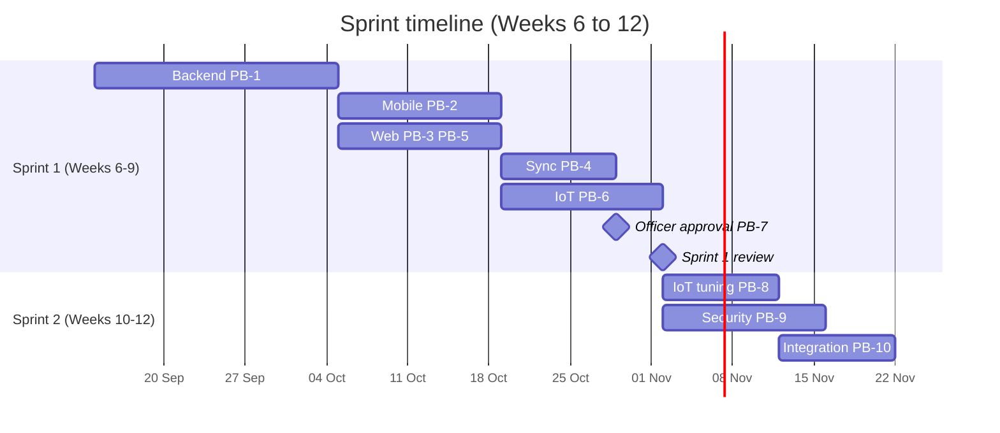
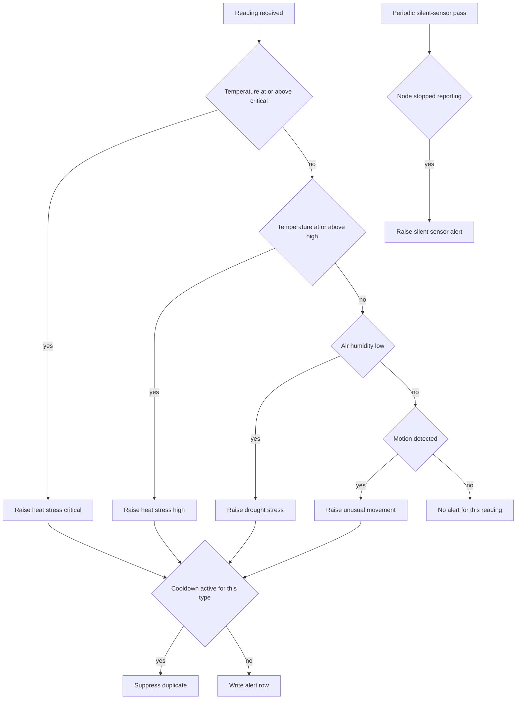
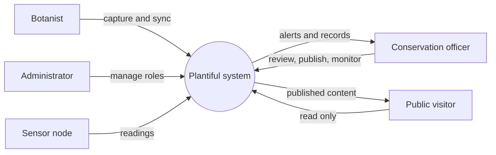
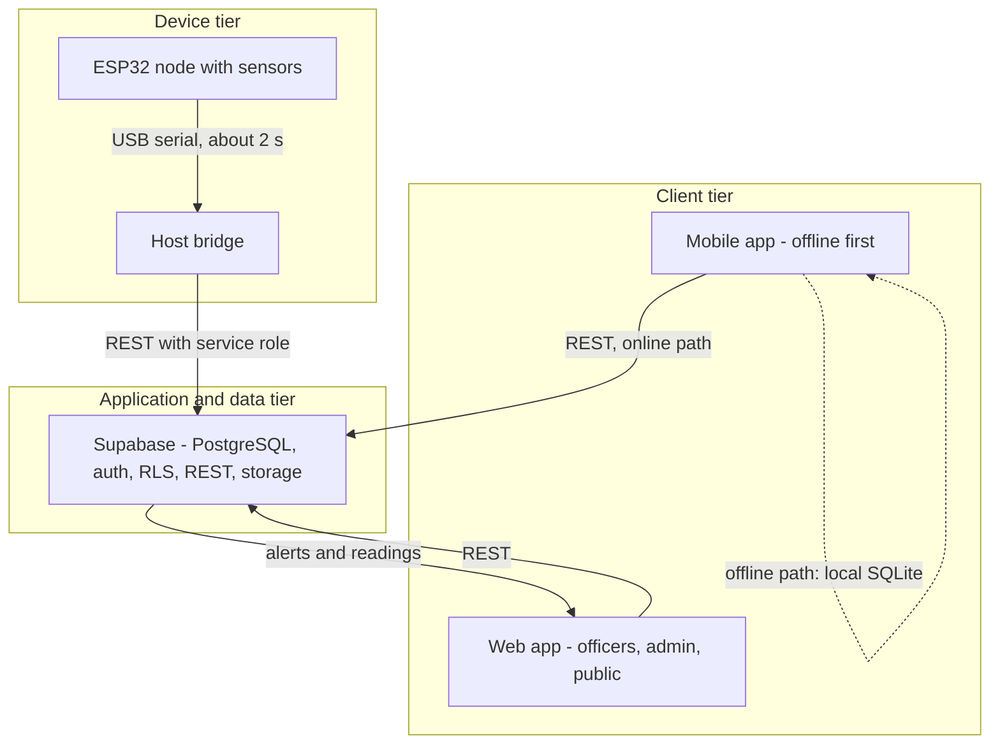
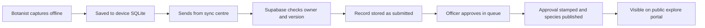
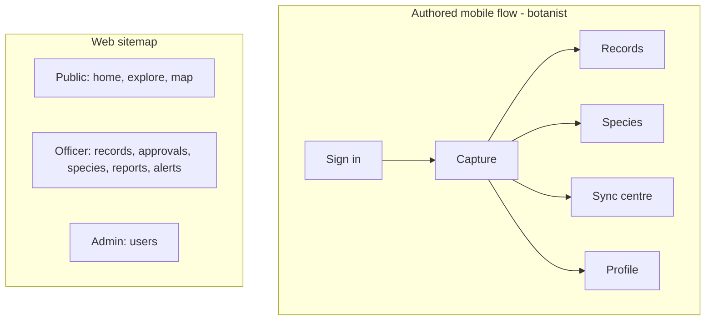
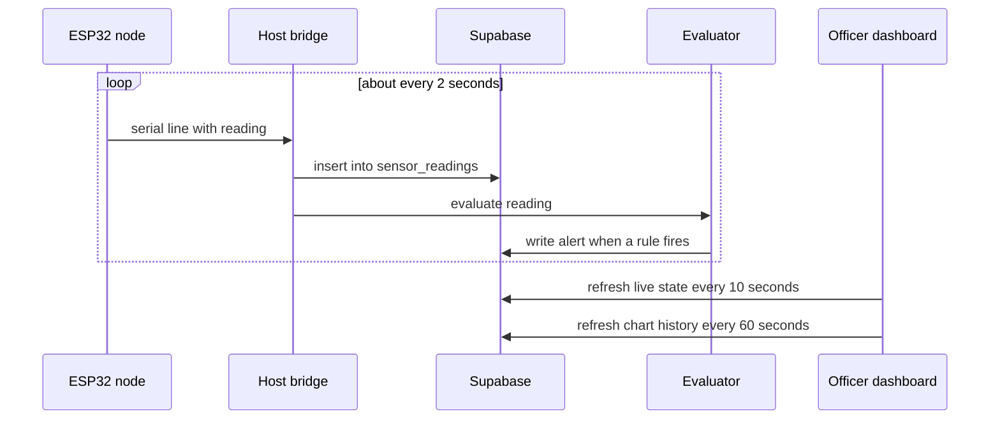
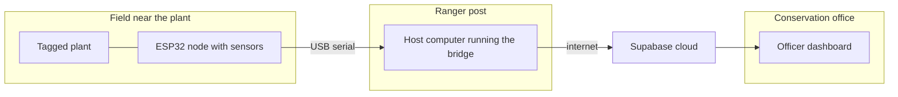

# Sprint Report Figures - Diagram Sources

These are the renderable sources for the figures referenced in `Docs/Reports/Sprint1/Sprint_Report_1.md`.
Render each Mermaid block to PNG or SVG (for example with the Mermaid CLI or the draw.io import), then paste it into Word.

Figures that do not suit Mermaid are listed at the end with their recommended tool.

---

## Figure 1. Sprint timeline (Section 1.2)

Dates below are indicative. Adjust to your actual trimester dates before rendering.



---

## Figure 4. Alert logic (Section 2.8)



---

## Figure 5. System context (Section 2.9)



---

## Figure 6. Three-tier architecture (Section 2.9)



---

## Figure 7. From capture to public record (Section 2.9.1)



---

## Figure 8. Navigation maps (Section 3.2)



---

## Figure 9. IoT data flow with timing (Section 3.4)



---

## Figure 10. Sequence, one observation (Section 3.6)

```mermaid
sequenceDiagram
    actor Bot as Botanist
    participant Mob as Mobile app
    participant DB as Supabase
    actor Off as Officer
    participant Pub as Public portal
    Bot->>Mob: scan QR and update record offline
    Mob-->>Mob: save to local store
    Bot->>Mob: send from sync centre
    Mob->>DB: push record and photo with version
    DB-->>Mob: accepted and version bumped
    Off->>DB: open approvals queue
    Off->>DB: approve record
    DB-->>Pub: record and species now visible
```

---

## Figure 11. Real-life deployment (Section 3.6)



---

## Figures that suit other tools

| Figure | Section | Recommended tool | Notes |
|---|---|---|---|
| Figure 2. ERD | 2.4 | draw.io or dbdiagram.io | Light background, show primary and foreign keys, group tables into identity, species, field records, IoT, and system. Replace the dark `Docs/Assets/ER_diagram.jpg`. |
| Figure 3. IoT wiring | 2.8 | Fritzing or Wokwi | Use the real GPIO pins below. Mark analog and digital pins and show power and ground. |
| Figure 12. Acceptance target status | 5.3 | draw.io or Excel | Traffic-light chart of the seven targets, marked verified, pending, or partial. |
| Figure 13. Security findings and gates | 5.4 | draw.io or Excel | Bar of findings by status plus a pipeline strip of the four workstream stages. |
| Figure 14. Committed versus delivered | 7.1 | draw.io or Excel | Bar chart of 51 committed, 59 delivered, 80 total. |
| Figure 15. Risk matrix | 7.2 | draw.io | Plot R1 to R7 and I1 to I2 by likelihood and impact. |

## Figure 3 pin map (from `iot/sketch_oct9a/sketch_oct9a.ino`)

These are the real pins in the firmware. Use them in the wiring diagram so a marker can cross-check the drawing against the code.

| Component | ESP32 pin | Type | Notes |
|---|---|---|---|
| DHT11 data | GPIO 4 | digital | temperature and humidity |
| PIR motion signal | GPIO 27 | digital input | |
| PIR indicator LED | GPIO 26 | digital output | optional on the diagram |
| Soil moisture signal | GPIO 34 | analog, ADC1 | input only, 12-bit |
| Rain sensor signal | GPIO 35 | analog, ADC1 | 12-bit |
| Power | 3V3 | power | |
| Ground | GND | ground | |

Calibration values in the firmware for the analog sensors: soil dry raw 4095, soil wet raw 1650, rain dry raw 4095, rain wet raw 2200. The analog pins use 11 dB attenuation for the full 0 to 3.3 V range.
