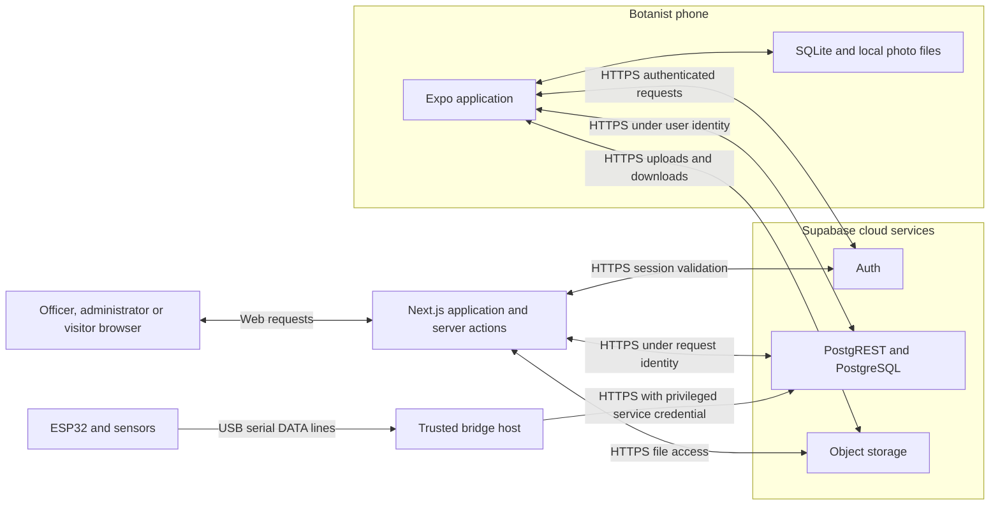
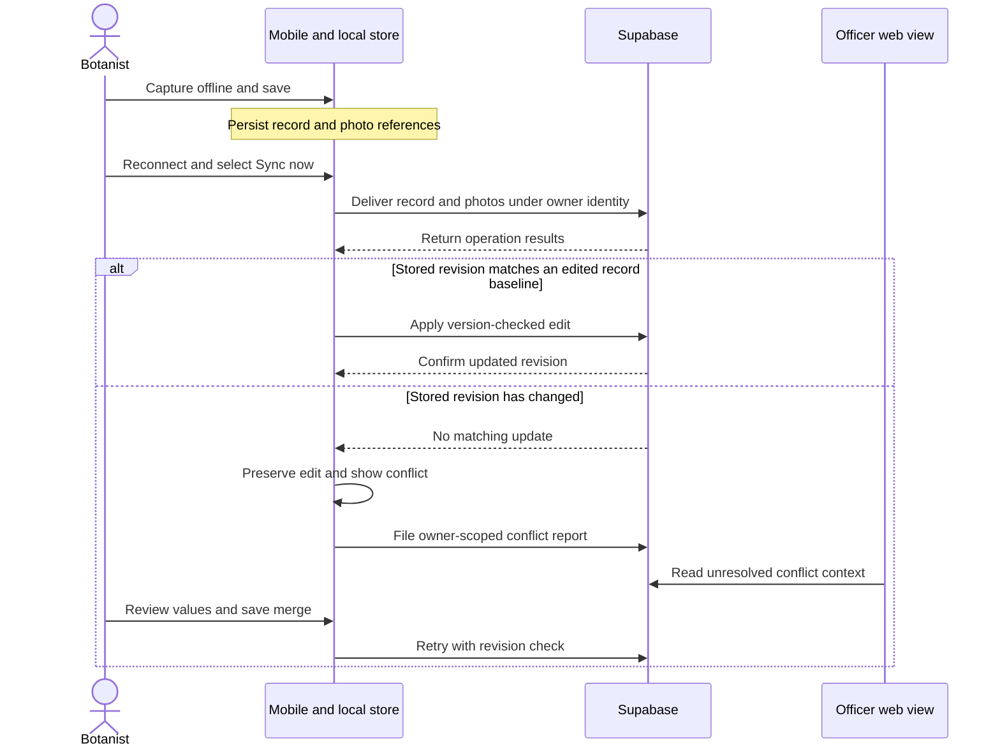
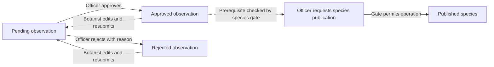
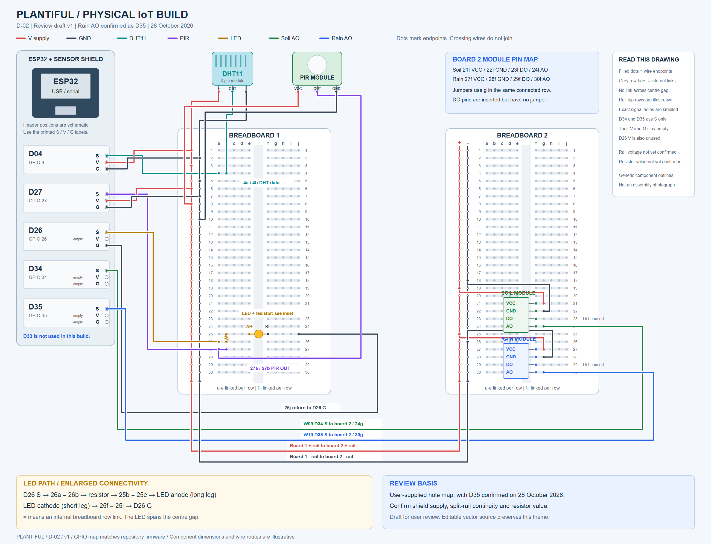
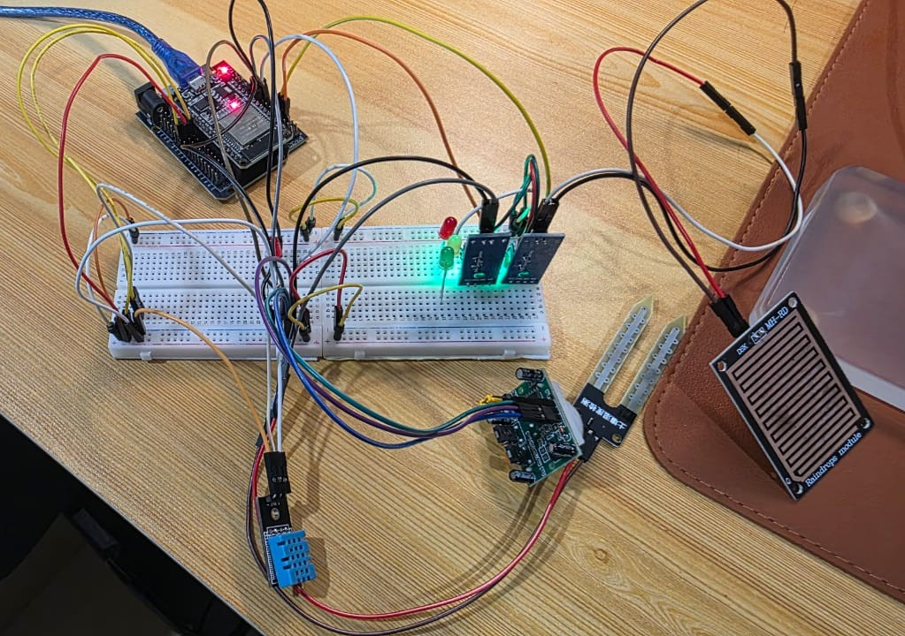

# Plantiful Sprint 2 Report

## Smart Ground-Truthing and Digital Biodiversity System

| Document field | Value |
|---|---|
| Unit | COS30049 Computing Technology Innovation Project |
| Team | Group 7, Plantiful |
| Project context | Plant species documentation and biodiversity knowledge for Niah National Park, Sarawak |
| Reporting period | Sprint 2, Weeks 10 to 12 |
| Submission target | 6 November 2026 |
| Evidence cut-off | Repository and GitHub review on 2 November 2026 |
| Repository baseline | `main` at `874e992` |
| Status | Evidence-backed working draft. Not a final readiness declaration |
| Prepared from | Sprint 2 planning documents, verification records, dated issue comments and pull requests |

This report follows the [Sprint 2 management plan](Sprint_2_Management_Plan.md) and the [product marking rubric](../../Marking_Rubric.md). It distinguishes work present on the reviewed baseline from work awaiting integration. Device results were recorded by the team. Preparing this report did not rerun those trials.

`[TBD]` identifies missing evidence or a decision that needs confirmation. Figure placeholders identify required exports. Neither is a completed result. Before submission, replace them with observed outcomes or an explicit limitation. Include accessible supporting files rather than relying on local-only paths.

## Executive summary

Sprint 2 focuses on completing, integrating and evaluating the Plantiful prototype. This follows Sue Han's direction to prioritise enhancements, system integration, testing, bug fixing and refinement once the basic requirements are implemented. The intended outcome is a stable prototype that can be demonstrated and explained using traceable evidence.

The strongest progress since Sprint 1 is the move from source-level checks to recorded device and live-database trials. An iPhone trial documents offline captures, persistence across an application restart, subsequent synchronisation, duplicate checks and officer approval returning to the phone. A Pixel trial documents capture, location, photo delivery, restart persistence and QR opening on Expo SDK 58. A separate conflict trial uses one physical phone and a scripted second client to demonstrate stale-edit rejection, preservation of the local copy and explicit merge resolution. These results support the tested workflows. They do not establish population-level reliability or a complete two-phone user experience.

Security and review behaviour also improved. Dated verification records describe removal of legacy policies permitting botanist self-approval, extension of the species publication gate to inserts, and a public write-block result recorded as 19 PASS with 6 data-dependent SKIP. Officer observation management was clarified as review rather than editing the botanist's field data. Rejections now carry a reason, and correction takes place through botanist editing and resubmission. The latest dependency record reports zero mobile audit findings and zero web production findings at the tested revision.

Sensor-payload validation, severity escalation and interruption recovery are now integrated on `main` as PRs #63 to #65. The combined IoT suite passes 36 tests, including database outage, USB reconnection and escalation cases. Alert resolution remains an open change in PR #62. Integrated tests are development evidence. Physical-node checks, the final alert-resolution decision and deployed-state verification remain necessary. Closed issue status is not treated as proof of deployed implementation.

Final readiness is not yet demonstrated. Outstanding work includes measured QR and sync acceptance trials, five-user usability evaluation, hardware calibration and assembly evidence, credential-rotation confirmation, final security reassessment, broader coverage reporting and sign-off. The report therefore presents verified progress and a bounded completion plan rather than claiming that every requirement has been met.

## 1. Sprint objectives and delivery control

### 1.1 Tutor direction and response

Sue Han advised that Sprint 2 should focus on final implementation, enhancements, integration, testing, bug fixing and overall refinement. She also requested that the team arrange the Sprint 2 sign-off meeting. The team translates that direction into four delivery objectives.

1. Verify the complete mobile, database and web workflow under normal and interrupted conditions.
2. Correct defects affecting data integrity, permissions and monitoring decisions.
3. Evaluate usability and performance using recorded tasks and measurements.
4. Deliver an explainable prototype with accurate diagrams, supporting evidence and an actual sign-off record.

New visual features are secondary to these objectives. A feature contributes to Sprint 2 when its user benefit, implementation status and verification are clear.

### 1.2 Starting baseline and change attribution

The [27 October baseline audit](Sprint_2_Management_Plan.md#2-baseline-and-provenance) identified gaps between the implemented prototype and its acceptance commitments. These included loose IoT input validation, bridge termination on service errors, unresolved calibration, incomplete coverage and outstanding device measurements. It also provided the starting dependency observations for remediation.

The baseline audit date is an engineering comparison point, not automatically the Sprint 1 submission cut-off. The exact submitted Sprint 1 PDF is retained at [Sprint 1 submission](../Sprint1/sprint1.pdf). Features already present there must not be claimed as newly built in Sprint 2 merely because their evidence was collected later.

| Product backlog | Sprint 2 interpretation |
|---|---|
| PB-7, review and approval | Verify the existing workflow and add the documented rejection-reason correction loop |
| PB-8, IoT refinement | Confirm the existing USB hardware path, calibrate sensors and validate alert/recovery behaviour |
| PB-9, security | Reassess the final release, fix permissions and dependencies, confirm credential remediation and close recommendations |
| PB-10, final integration | Complete acceptance trials, usability evaluation, documentation, handover and demonstration |

[TBD] Confirm the Sprint 1 submission cut-off and the reporting dates with the team lead. Attribute work by demonstrated behaviour and dated evidence, not commit counts alone.

### 1.3 Work-package status at the evidence cut-off

The following status is an evidence classification. It does not derive a completion percentage from GitHub issue counts. Coordination roles are taken from the planning workspace and require confirmation of final individual contributions.

| ID | Work package | Coordination | Issue or PR | Evidence position |
|---|---|---|---|---|
| S2-01 | Dependencies and SDK 58 | Web and mobile owners | #43 | Verification recorded at `9a4d99b`. Mobile audit zero, web production audit zero. Hosted deployment not verified |
| S2-02 | Credentials and accounts | Authorised Supabase owner | #41 | Rotation and password-reset confirmation outstanding |
| S2-03 | Publication and role policies | Backend and web owners | #44 | Live verification recorded on 29 and 31 October, with a subsequent issue-comment recheck |
| S2-04 | IoT payload validation | IoT owner and PR author | #45, PR #63 | Integrated in `39e5150`. Validation and combined IoT tests pass. Physical-node verification outstanding |
| S2-05 | IoT interruption recovery | IoT owner and PR author | #46, PR #65 | Integrated in `854cffb`. Simulated outage and USB reconnection tests pass. Physical-node verification outstanding |
| S2-06 | Alert escalation | IoT and officer-workflow owners | #47, PR #64 | Integrated in `c49d33b`. Severity escalation through cooldown is tested. Operational cooldown acceptance outstanding |
| S2-07 | Interval and calibration | Hardware holder | #48 | Physical measurements outstanding |
| S2-08 | Wiring and assembly | Hardware holder | #49, #58 | D35 confirmed and D-02 draft available. Electrical and assembly confirmation incomplete |
| S2-09 | Alert resolution | Web and backend owners | #31, PR #62 | Branch implementation available. Integration and database state need release confirmation |
| S2-10 | Observation-management scope | Web and mobile owners | #16 | Agreed scope and rejection-reason implementation documented. Database restrictions verified in dated records |
| S2-11 | Species mutation feedback | Web owner | #50 | Live happy-path, missing-row, concurrent-delete and denied-role results recorded |
| S2-12 | Location recovery | Mobile owner | #51 | Four Android permission/service scenarios recorded, including defect correction |
| S2-13 | Alert-flow diagram | IoT and documentation owners | #52 | Update required to match the eventual integrated policy |
| S2-14 | Security close-out | Security and component owners | #53 | Final reassessment and recommendation dispositions outstanding |
| S2-15 | Acceptance and usability | Testing coordinator and team | #39, #40 | Conflict evidence recorded. QR, reliability and participant measurements outstanding |
| S2-16 | Whole-scope coverage | Component owners | #54 | Helper coverage recorded. Wider denominator and coverage gaps unresolved |
| S2-17 | Diagrams and evidence | Documentation owner | #55 | Existing captures and D-02 draft available. Final packaging incomplete |
| S2-18 | Report, sign-off and rehearsal | Team lead and whole team | #56 | This report is drafted. Meeting outcome and rehearsal results outstanding |
| S2-19 | Issue reconciliation | Team lead and issue owners | #57, PR #60 | Scope comments exist. Documentation PR remains open and some original issue wording is stale |

### 1.4 Schedule and release sequence

| Period | Recorded activity or remaining gate |
|---|---|
| 27 to 28 October | Baseline review, work-package planning and D-02 draft |
| 29 to 31 October | Publication/review and species-feedback fixes. Offline iPhone trial and database verification |
| 1 to 2 November | Pixel permission, conflict and dependency regression records. IoT and alert-resolution PRs opened |
| Next integration gate | PRs #63 to #65 are integrated. Review PR #62 and the documentation PR #60, apply required database changes and record the combined release revision |
| Next evidence gate | Physical IoT trials, measured acceptance, usability, security reassessment and coverage analysis |
| 5 November internal target | Reviewed report, accessible evidence package and completed rehearsal |
| 6 November submission target | Inspect uploaded files and retain submission receipt |

[TBD] Confirm the meeting booking, participant availability and exact submission time. Proposed dates are not evidence that an activity occurred.

## 2. User needs and requirement coverage

### 2.1 Users and data ownership

Botanists need to capture observations when connectivity is unavailable. Officers need to review those observations, maintain shared species knowledge and inspect monitoring alerts. Administrators manage roles. Visitors need access to information authorised for publication.

A species is a catalogue entity, while an observation is a field record linked to it. One species can have observations from several botanists at different locations. Officer catalogue management must therefore remain distinct from ownership of field observations. Under the recorded scope decision, officers approve or reject observations rather than rewriting or deleting the botanist's content. The botanist performs corrections and resubmits for review.

### 2.2 Traceability matrix

Evidence identifiers are defined in Appendix A. A successful example establishes the stated scenario, not all possible inputs or environments.

| User need or requirement | Implementation or proposed change | Verification | Current conclusion |
|---|---|---|---|
| Capture without connectivity | SQLite-backed observations and local photo files | EV-01, INT-01 | Three deliberately offline records were retained and later uploaded in the recorded trial |
| Preserve data through restart | Persisted local records, photo references and sync state | EV-01, EV-03 | Persistence observed. Fully offline Expo Go cold launch not established |
| Deliver records without unintended duplicates | Stable record identity and repeat-sync handling | EV-01, EV-03 | Repeat sync produced no duplicate in the recorded fixtures. Interrupted photo-upload coverage still needs explicit evidence |
| Avoid silent competing-edit overwrite | Version compare-and-swap, conflict state and per-field merge | EV-02, INT-03 | Two conflict cycles recorded using a phone and scripted second client |
| Retrieve a record from a QR tag | Camera decoder and record lookup | EV-03, PERF-01 | Live QR opening recorded. Offline timing target not established by that result |
| Review without changing field ownership | Reject with reason, botanist correction and resubmission | EV-04 | Browser and policy results recorded. Retain a final phone rejection-to-resubmission trace |
| Manage species accurately | Officer species actions with affected-row checks | EV-05, WEB-01 | Happy path and failure feedback verified in recorded live checks |
| Provide public information safely | Read policies and separate observation/species visibility rules | EV-04, SEC-01 | Tested role and lifecycle cases passed. Final combined-release retest required |
| Search, map and export biodiversity information | Existing web catalogue, map and reports | WEB-01, EV-03 | Page rendering is recorded. Final search/map and actual CSV/PDF download checks must be attached |
| Capture location with usable recovery | Manual Capture GPS action and Open settings recovery | EV-06 | Four Android scenarios recorded. Automatic GPS stamping is not claimed |
| Monitor and respond to threats | Existing monitoring plus integrated PRs #63 to #65. PR #62 remains open | EV-08, IOT-01 to IOT-03 | Integrated IoT tests pass. Physical node and final alert-resolution verification outstanding |
| Protect accounts and sensitive information | Auth, RLS, storage policies, transport controls and secret handling | EV-04, EV-07, SEC-01 to SEC-03 | Selected controls verified. Credential remediation and final reassessment remain open |
| Support efficient field and officer tasks | Navigation, status feedback and recovery refinements | UX-01 | Developer/device observations exist. Independent user task results outstanding |

## 3. Implementation changes and justification

### 3.1 Baseline, decision, outcome and limitation

| Area | Observed problem | Change and rationale | Verification and boundary |
|---|---|---|---|
| Publication gate | Published inserts were not covered by the update-only gate | Include inserts and updates so the entry path cannot bypass the approved-observation prerequisite | Live lifecycle probes reported in #44. Preserve exact deployed SQL and output |
| Botanist permissions | Legacy permissive policies combined with hardened policies and allowed self-approval | Remove legacy policies rather than relying on UI restrictions | Direct backend denial checks and 19 PASS with 6 data-dependent SKIP recorded |
| Review correction | Review needed a clear explanation and resubmission path | Require a rejection reason and clear it on resubmission. Botanists retain responsibility for field content | Browser and database results recorded. Sprint 1 already described approve/reject, so the new claim is the reason and enforcement improvement |
| Species mutations | A zero-row mutation could appear successful | Request the affected identity and return Species not found when nothing changed | Four live cases recorded in #50. Automated web regressions remain a gap |
| GPS failure recovery | Some forms showed a dead-end error after denied permission | Offer Open settings and retain entered fields across recovery | Device trial found two missing call sites, fixed in `7c10326` and retested |
| Conflict visibility | Officers lacked context when the botanist had an unresolved edit | Add owner-scoped conflict reports and an officer-visible banner | Two conflict cycles and banner access checks recorded in EV-02 |
| Dependencies | Vulnerable transitive mobile tooling remained after the SDK upgrade | Use compatible SDK 58 updates and patched dependency overrides instead of a forced downgrade | Recorded audits and six regression steps at `9a4d99b`. Overrides require continued maintenance |
| Appearance and layout | Device review identified gesture-bar clearance and inconsistent spacing | Adjust insets, controls and typography. Provide Light, Dark and System appearance | Implementation and device-review history exist. Participant benefit and final contrast checks are not yet measured |

### 3.2 IoT integration and remaining change

The validation, escalation and recovery changes are now integrated on `main`. The open resolver change remains a proposal.

| PR | Implementation | Why this approach | Verification and limitation |
|---|---|---|---|
| #63 | Reject malformed, non-finite and out-of-range bridge readings before insertion | Rejecting a bad line preserves evidence of sensor failure instead of silently clamping it into a believable measurement | Integrated in `39e5150`. Bridge validation tests pass. Simulator and direct-write paths are not hardened by this change |
| #64 | Allow higher severity to escalate through cooldown while suppressing equal or lower severity | Balances alert fatigue against the risk of hiding a worsening condition | Integrated in `c49d33b`. Cooldown and escalation tests pass. The six-hour default still needs operational justification |
| #65 | Buffer readings in memory, retry uploads with backoff and reconnect USB | A bounded buffer avoids immediate process termination and limits memory growth | Integrated in `854cffb`. Recovery tests pass. This is not durable storage, so buffer overflow, bridge shutdown and USB-gap readings can still cause loss |
| #62 | Allow officers and admins to resolve alerts, with database-stamped resolver and time | Officers need a recorded response action rather than a read-only alert list | Not integrated. Final resolution cannot be reopened. Confirm workflow acceptance and apply the deployed migration before claiming completion |

The integrated recovery buffer holds 1,800 readings by default, approximately one hour at a two-second interval. This is a capacity calculation, not a measured one-hour endurance result. The recovery policy does not justify claiming zero loss under every interruption. A timeout after a server commit but before acknowledgement also needs an explicit duplicate and retry test before claiming exactly-once IoT storage.

### 3.3 Decision register

| Decision | Evidence or status | Trade-off |
|---|---|---|
| Officer review rather than observation edit/delete | Scope agreement recorded in #16 on 29 October | Protects authorship but requires a clear rejection/correction workflow |
| Compare-and-swap rather than last-write-wins | Existing Sprint 1 design, with expanded Sprint 2 evidence and visibility | Prevents silent overwrites but requires user resolution of conflicts |
| USB bridge rather than MQTT deployment | Existing delivered transport | Reduces prototype integration dependencies but requires a trusted host and cable |
| Severity escalation and final alert resolution | Escalation integrated and tested. Final resolution remains an open change | Reduce suppressed critical alerts and ambiguous resolution, but final resolution still needs acceptance and deployed verification |
| No application-level field encryption | Rationale recorded in the security assessment | RLS and platform controls are distinct from field encryption. Acceptance against the original objective still needs explicit confirmation |
| Curved navigation and photo-led cards | Implemented in the working tree from user-supplied references. Not merged, captured or device-verified | Potential visual coherence must be weighed against readability, rendering cost and navigation stability |

### 3.4 Visual change evidence

Screenshots will make the Sprint 2 improvements easier to inspect. They must show the actual application, not mockups or design references. Each capture uses the same viewport, account role and data state for the before and after views.

The IMG-S2 series is planned. Insert a capture only after the change is implemented and verified on the recorded build. Label every image with its test ID, build or commit, date and role. Redact personal data and sensitive locations.

| Image ID | Change shown | Required capture | Caption must state |
|---|---|---|---|
| IMG-S2-01 | Web homepage photo-led cards | Discover, Connect and Conserve sections at one viewport. Include the previous layout for comparison | Image source and licence. Cards shown are implemented content. Do not claim a usability gain without participant evidence |
| IMG-S2-02 | Officer approval photograph review | Queue with thumbnails, a larger inspection view and one record with no photo | Record IDs are redacted. The missing-photo state is deliberate. The photo is the botanist submission, not a catalogue substitute |
| IMG-S2-03 | Mobile curved bottom navigation | All five tabs at rest, with each selected state in light and dark appearance | Tab labels remain visible. Touch targets and gesture-area clearance were checked. Decoration does not replace the accessible name |
| IMG-S2-04 | QR scanner guide animation | Two or three still frames showing the guide and scan line at different positions, or a short muted clip | The animation shows readiness only. It does not prove a successful decode |
| IMG-S2-05 | Photo-led species list | Before and after cards for the same species. Include one species with no photograph | The long description moved to the detail screen. The fallback is deliberate |
| IMG-S2-06 | Unknown QR resolution states | Found locally, found online, offline unavailable, not accessible, unsupported tag and deliberate new-tag confirmation | Each panel names the input state and observed message. A failed lookup does not automatically start a new record |
| IMG-S2-07 | Light and dark appearance | Web and mobile screens at the same task and viewport | Contrast was checked by the stated method. Fixed camera and QR surfaces are excluded from theme inversion |
| IMG-S2-08 | Offline sync and conflict feedback | Pending, synced, failed and conflict states. Include the officer conflict banner | Test ID, revisions and whether the second client was scripted. The banner is visible to the intended role |
| IMG-S2-09 | IoT reading to dashboard trail | Annotated assembly, serial output, stored reading and dashboard alert with correlated values | Physical and synthetic labelled separately. Calibration and wiring limitations stated |
| IMG-S2-10 | Layout and spacing refinements | Before and after mobile screens at the same viewport, including the gesture-bar area | The observed defect, the change and the retest result. Device and build identified |

Do not place an unlabelled image between two paragraphs and leave the reader to infer its meaning. Introduce it in the text, keep the caption factual and link it to the change or test it supports.

### 3.5 Working-tree refinements awaiting integration

These refinements exist in the current working tree. They are not merged, captured or verified on a physical device. Treat them as implementation status, not delivered results.

| Area | Refinement | Verification boundary |
|---|---|---|
| Unknown QR resolution | Distinguish local, online, offline, inaccessible and unsupported outcomes. Replace the automatic new-record path with Scan again | Six helper tests pass on the working tree. Device states and final captures remain outstanding |
| Species list readability | Lead with the reference photograph, trim the summary and label the conservation value explicitly | Working-tree implementation. Photograph licence and offline image behaviour still need verification |
| Scanner guidance | Add a reduced-motion-aware scan line that pauses when the tab loses focus or the app is backgrounded | Animation indicates readiness only. It does not prove a successful decode |
| Bottom navigation | Use a curved animated selected indicator while keeping tab order, labels and accessible names stable | Touch targets, gesture-area clearance and both appearances need device checks |
| Officer review evidence | Show submitted observation photographs with a larger inspection view and an explicit missing-photo state | Photograph is the botanist submission, never a catalogue substitute. Queue capture outstanding |
| Homepage discovery | Use owner-supplied Rafflesia, hornbill and orangutan photographs behind forest-green frosted panels. Keep a solid fallback for unsupported blur and reduced transparency | Images are homepage artwork, not field evidence. Image provenance and contrast checks remain outstanding. No usability benefit is claimed |

### 3.6 Optional Additional Innovation implementation

The [Additional Innovation tracker](Additional_Innovation_Tracker.md) maintains the issue register, development verification snapshot, activation checklist and planned screenshots for this section. Update it as deployment and evaluation evidence becomes available.

AI Field Assist is implemented in the working tree under issues #76 through #84. It combines offline evidence-completeness checks, hosted species suggestions, reviewed catalogue guidance and separate collector and officer identification decisions. The checklist supports incomplete offline saves. The backend validates record access, archives analysed images privately and detects changed evidence before accepting a decision. AI output does not automatically confirm a species or change publication status.

The [implementation and setup guide](../../Guides/AI_Field_Assist.md) records provider contracts, deployment configuration and limitations. The [evaluation protocol](../../Testing/Additional_Innovation/README.md) separates software regression tests from live species-accuracy and participant results. The new migration has not been applied to the deployed project. Provider credentials, independently labelled observations and participant trials remain necessary. No improved identification accuracy, fieldwork speed or scalability is claimed yet.

## 4. Architecture and integration

### 4.1 Deployment and trust boundaries

The mobile app stores observations in SQLite and photographs in local files. It communicates with Supabase as the authenticated user. The Next.js application includes browser and server responsibilities, with role checks in server actions and database policies. Supabase provides Auth, PostgreSQL/PostgREST and object storage. The physical node sends serial readings to a trusted host bridge. The bridge uses a privileged service credential for ingestion.

Cloud API and storage connections use HTTPS. The ESP32-to-host connection is USB serial, not HTTPS. Development-server connections must be described separately from production transport. The service credential bypasses normal RLS, so user-role tests do not establish that bridge operations are constrained by those same policies.

The following editable figure is a documentation draft for owner review. It describes the baseline deployment, not a newly tested installation.

Figure D-01. Deployment responsibilities and trust boundary. The local store supports disconnection. The host bridge is the privileged component. Browser-side Supabase calls also occur where required by authentication flows. Export a readable vector figure and confirm all arrows against the final release.

### 4.2 Data model

The changes listed below comprise one table and three columns across merged and proposed work. This is an inventory of the changes described here, not a claim to be a complete schema diff.

| Entity | Change | Status |
|---|---|---|
| `sync_conflicts` | New table recording unresolved edits with owner-scoped access | Recorded in the current conflict implementation |
| `plant_records` | `rejection_reason` | Recorded in the current review implementation |
| `alerts` | `resolved_by` and `resolved_at` | Proposed through PR #62. Confirm release database state |

One species can have many observations. Each observation has its own owner, location, measurements, photos, revision and review state. Species publication is separate from observation approval. The ERD must show actual keys and relationships rather than infer relationships from similar names.

[picture of D-06 ERD grouped into identity, species, observations, conflicts, IoT and reporting here]

### 4.3 Synchronisation and review

The normal path is local capture, explicit Sync now, record delivery, photo delivery and confirmation. Edits compare the device's baseline revision with the server revision. A stale edit remains locally available and enters conflict review. The botanist chooses the values to retain before another version-checked submission.

Figure D-04. Normal delivery and competing-edit decision points. Each operation can fail and must retain a recoverable local state. This figure is explanatory, not evidence that interrupted photo transfer has been exercised.

Figure D-05. Observation review and species publication are separate lifecycles. Resubmission clears previous review fields. Actual anonymous visibility must be tested at each transition, including re-review, direct URLs and storage access. The diagram does not imply that changing observation state automatically changes the species publication flag.

### 4.4 IoT flow and hardware evidence

The documented IoT path uses an ESP32-WROOM-32 node with a DHT11 temperature and humidity sensor, a PIR movement sensor, an analogue soil-moisture board, an analogue rain board and a status LED. The firmware prints a human-readable QC table and then one `DATA {json}` line for each reading. The host bridge reads the data line, stamps the arrival time with host UTC time and inserts the row into `sensor_readings` with the service role. PR #63 adds stricter malformed, non-finite and out-of-range rejection. Its release status must be confirmed before claiming integrated validation. The evaluator applies the heat, low-humidity and movement rules and writes alerts. The `/alerts` page reads the stored readings and alerts for officers.

The node-to-host link is USB serial. It is not HTTPS. Transport security applies to the bridge-to-Supabase request, not to the cable. The node has no clock and no GPS receiver. The bridge supplies the timestamp and registers a fixed deployment coordinate. The simulator writes to the same tables through the same insert path, so a simulated reading must never be presented as a physical trial.

Figure D-02 is the physical wiring review draft. It maps each module to the ESP32 pins, shows the shared power and ground rails and colours each signal path. The soil and rain boards use their analogue outputs. The draft shows an LED driven through a series resistor. Rain AO to D35 is confirmed by the hardware owner. An actual assembly photograph is now included below. Supply voltage, resistor value, exact module variants and a pin-by-pin comparison remain outstanding. The draft is a design review artefact, not electrical verification.

| Sensor or output | ESP32 pin | Stored field | Reading behaviour |
|---|---|---|---|
| DHT11 data | GPIO4 | `temperature`, `humidity` | A failed read is stored as null rather than a fabricated value |
| PIR output | GPIO27 | `movement` | Digital movement indication. Actual module output voltage needs confirmation |
| Soil board AO | GPIO34 | `soil_moisture` | Analogue value converted to a percentage |
| Rain board AO | GPIO35 | `rain` | Analogue value converted to a boolean by threshold |
| LED anode via resistor | GPIO26 | none | Local status indication only |

The final D-03 must distinguish the baseline from the proposed pipeline. After PR integration, it should show serial receipt, arrival timestamping, validation, bounded buffering, upload retry, independent rule checks, severity-aware cooldown, periodic silence checks and dashboard resolution. The simulator must appear as a separate source rather than as evidence of a physical run.

[picture of D-03 reading-to-alert and recovery flow after final PR integration here]

The supplied assembly photograph is explained below. Physical evidence still needs a verified wiring comparison, a correlated serial line, stored row and resulting alert, and an interruption trial. The current D-02 image supports wiring review only.

Figure IMG-S2-09a. Actual assembly supplied by the hardware owner. The root original `IOT.jpeg` is retained and an unchanged evidence copy is organised under `Docs/Testing/Evidence/sprint2-iot/`. The controller is at the upper left, the breadboard is central, the blue temperature and humidity module is below it, the soil probe is at the centre right and the rain plate is at the far right. The lower sensor board is viewed from underneath and needs a readable model label. Red and green LED packages are visible, so the single-LED draft needs reconciliation. This photograph documents the assembly but does not prove the pin mapping, electrical values, calibration or a successful data upload. See the [assembly evidence notes](../../Testing/Evidence/sprint2-iot/README.md).

### 4.5 Follow-up user checks

The owner reports that the mobile phone checks work fine. This is informal feedback covering the supplied checklist, not individually recorded test results. Device details, timings and screenshots are still needed for reproducible evidence. A [short usability session sheet](../../Testing/Sprint2_Usability_Session.md) provides participant tasks, outcome recording and a simple task-ease question. Participant sessions remain unrecorded.

## 5. Testing plan and environment

### 5.1 Definition of Done and evidence strength

A work package is verified when its retained acceptance criteria pass on an identified revision, relevant regressions pass, unresolved results are documented and supporting evidence is accessible. A final deliverable also requires integration into the release and any necessary database migration. A closed issue, passing build or attractive screenshot alone is insufficient.

Three evidence levels are distinguished in this report.

1. Recorded device or live-system observations establish the stated procedure and environment.
2. Automated branch tests establish the exercised code behaviour under their fixtures.
3. Plans and design references establish intended work only.

Where only a narrative result exists, retain the underlying output before submission. A source file containing a test is not itself the result of executing that test.

### 5.2 Acceptance criteria and measurement rules

| Attribute | Retained target or acceptance basis | Measurement rule |
|---|---|---|
| Sync reliability | Greater than 95% success with no observed data loss | Successes divided by all recorded attempts under the agreed protocol. Include retries and conflicts and report scenario groups |
| QR performance | Mean full scan-to-record time below five seconds | Record full task time separately from decoder-callback lookup latency. The latter alone does not establish the full target |
| Coverage | Greater than 80% over the agreed backend API and mobile-sync scope | Declare included modules and coverage measures before measuring. Report helper coverage separately |
| Integrity | No unintended duplicates or silent overwrite in the tested cases | Compare record/photo identities, content and revisions after retries, conflicts and interruptions |
| Access control | Agreed role and ownership matrix holds | Test permitted and denied operations through direct backend requests as well as the UI |
| Usability | Greater than 90% unassisted task completion across the planned five-user evaluation | Unassisted completions divided by eligible assigned task attempts. Assisted completion is not unassisted success |
| IoT | Payload, alert and recovery policies hold | Test synthetic negatives and physical events separately, with timing and loss boundaries stated |

Sample sizes and task assignments must be fixed before trials. Do not remove deliberate failures from the headline denominator after seeing the result. Scenario-specific results may explain the outcome but must be labelled. Zero samples mean not measured. With small samples, report exact counts and avoid generalising to all field conditions.

### 5.3 Test identifiers

| ID | Scope | Remaining evidence focus |
|---|---|---|
| INT-01 | Offline persistence and review/publication workflow | Extend recorded sync/approval evidence with final anonymous visibility checks |
| INT-02 | Interrupted record/photo upload and retry | Explicit interruption after record insertion or during photo transfer |
| INT-03 | Competing edits and merge | Retain phone/script limitation. Run two physical installations if claiming that UI coverage |
| INT-04 | Publication lifecycle | Pending, approved, rejected, resubmitted and species publish/unpublish states |
| PERF-01, REL-01 | QR and sync measurements | Raw export, sample count, timing boundaries and denominator |
| IOT-01 to IOT-03 | Hardware, rule behaviour and malformed input | Final branch integration, calibration, physical recovery and correlated reading/alert evidence |
| SEC-01 | Role, storage and publication permissions | Release database matrix and full output with skipped cases visible |
| SEC-02 | Dependencies | Dated audit JSON with scope and tested lockfile/revision |
| SEC-03 | Headers, errors and dynamic scans | Release target, anonymous/authenticated contexts, actual scan method and exclusions |
| WEB-01 | Web regression | Search, maps, photos, exports, monitoring and denied-role feedback |
| UX-01 | Participant tasks and guideline review | Participant/task outcomes, observations, changes and retests |

These identifiers follow the existing [testing plan](Sprint_2_Management_Plan.md#4-testing-and-evidence-plan). UX-01 is used consistently rather than introducing a competing USE-01 identifier.

### 5.4 Recorded environments

| Trial | Environment and revision | Boundary |
|---|---|---|
| #23, 31 October | Physical iPhone, Expo Go SDK 58, Codespaces/ngrok, live Supabase, `8ce612e` | Phone model and iOS version still need recording. Network used to reload Expo Go after closing |
| #39, 1 November | Pixel 9 Pro XL, Android 17, Expo Go SDK 58, `73278e8`, same-owner scripted second client | Not two physical phones |
| #43, 1 to 2 November | Pixel 9 Pro XL, Expo SDK 58.0.22, `9a4d99b`, web Next.js 16.4.3 | Local application runs against live Supabase, not hosted-release verification |
| #51, 1 November | Pixel 9 Pro XL, Android 17, Expo Go 58.0.5, `7c10326` | Android permission scenarios. iOS equivalents not exercised |
| #44 and #16 policy records | Live database checks on 29 and 31 October, Linux/Node 22 recorded in comments | Preserve deployed policy definitions and raw output |
| IoT integrated regressions | PR #63 `39e5150`, PR #64 `c49d33b`, PR #65 `854cffb` | Fake service/serial fixtures. Combined suite of 36 tests passes on the integrated revision |

Expo SDK/package version and Expo Go client version are different fields. Record both. Final trials also need browser version, host OS, firmware version, migration state and network conditions. Do not replace missing exact versions with a broad value such as Node 20+.

## 6. Results, interpretation and limitations

### 6.1 Recorded results

| Evidence | Observed result in the source record | What it supports | What it does not establish |
|---|---|---|---|
| EV-01, #23 | Eight steps reported PASS. Four records uploaded, each with one photo and no duplicate on repeat sync | Offline record retention, later delivery, review and approval returning to phone | Four offline captures. One record uploaded while Wi-Fi remained on, leaving three deliberate offline captures |
| EV-02, #39 | Nine steps reported PASS across two conflict cycles, with version progression to 5 | Stale-edit refusal, preserved local choices, merge and conflict-banner lifecycle | Two-phone UI operation or every cross-owner content-edit case. Step 9 specifically records denied conflict filing |
| EV-03, #43 | Six regression steps reported PASS | Device capture, restart, photo delivery, repeat sync, QR opening and selected web checks after dependency changes | Hosted deployment, full report-export verification or offline QR timing |
| EV-06, #51 | Four permission/service scenarios reported successful | Recovery from denied/unavailable location while retaining form fields | Equivalent iOS behaviour or automatic GPS stamping |
| EV-04, #44 | Issue #44 reported 18/18 public write-block checks. The retained 10 October SQL output records 19 PASS and 6 data-dependent SKIP | The executable policy checks passed. Skipped probes were not counted as passes | Exhaustive security assurance or all storage/publication transitions |
| EV-04, #16 | Eleven-point live battery reported successful | Agreed review restrictions and selected owner/admin behaviours | Full regression on an eventual combined release |
| EV-05, #50 | Four live UI/role cases reported successful | Accurate species mutation feedback, including missing rows | Automated web regression coverage |

### 6.2 Automated verification and audit scope

The verification record reports passing mobile type checks, lint, unit tests and a Metro Android bundle at `9a4d99b`. It also reports web production dependency findings at zero, while noting development-tool findings separately. The mobile audit is recorded as zero across the reported audit scope after dependency overrides.

Do not rewrite this as both applications having zero vulnerabilities in every scope. An audit is a dated known-advisory check, not proof that application vulnerabilities are absent. The older October JSON files must not be presented as the raw evidence for the November result.

| Suite or branch | Recorded result | Reporting constraint |
|---|---|---|
| Mobile sync helper | Four tests and 100% helper coverage reported in the execution backlog | Not overall mobile or full sync-screen coverage |
| QR lookup helper | Six tests recorded on the current working tree, covering cached, remote, unresolved, storage-failure and timeout paths | Working-tree result. Not a merged-release result and not device coverage |
| Measurement summariser | Historical two-test pass | Attach a release-revision rerun before quoting it as final |
| IoT integrated suite | 36 tests pass on `main` after PRs #63 to #65 | Unit tests with fake service and serial fixtures. Not physical-node or hardware-in-the-loop evidence |
| Web | 6 November re-test recorded type check, lint and 42 passing tests. The production build was blocked by host memory after compile and type check | Build success is not runtime behaviour or coverage. No current build result is claimed |

A repeat on the current working tree passed mobile type check, lint, ten helper tests, Expo Doctor 20/20 and an Android Metro export. The web type check and production build also passed, with one image-optimisation lint warning recorded. These are pre-integration working-tree checks.

The 6 November 2026 re-test passed mobile type check, lint and 21 tests. Expo Doctor passed 19 of 20 checks and reported five version mismatches. Web type check, lint and 42 tests passed. The web production build compiled and type checked, then a page-data worker ran out of memory on this host. The current evidence therefore supports the test results but not a completed web production build.

Do not sum hypothetical future test counts into a current release total. Likewise, route counts from different revisions or build-output conventions should not be treated as a quality metric.

### 6.3 Initial failures and retests

| Observation | Interpretation | Response and result |
|---|---|---|
| First #23 record uploaded while Wi-Fi remained enabled | Test-procedure error, not an offline-storage failure | Later captures used airplane mode. Only three are counted as deliberate offline captures |
| Permission recovery missing on discover/edit screens | Real UI recovery defect found by device testing | Added recovery actions in `7c10326`, with same-device verification recorded |
| RLS probe referenced a nonexistent column | Test-fixture defect, not proof of a policy failure | Probe corrected in `1a289a5` and 18/18 reported. The retained 10 October SQL rerun records 19 PASS and 6 data-dependent SKIP |
| Stale same-owner edits refused | Expected integrity behaviour | Local content retained, merge performed and subsequent revision checked |
| IoT timeout terminated the bridge | Baseline reliability defect reproduced in PR work | Recovery integrated in `854cffb`. All 36 IoT tests pass, including database outage and USB reconnection. Physical-node retest remains outstanding |

The report retains these observations rather than claiming every initial test passed. Final passing results must be linked to the correction and retest revision.

### 6.4 Acceptance targets still to measure

| Target | Current status | Required completion |
|---|---|---|
| Greater than 95% sync success | Not measured under the agreed acceptance protocol | REL-01 export with all attempts, scenario groups and loss/duplicate checks |
| Mean scan-to-record below five seconds | Not measured | PERF-01 full-task measurements plus separately labelled lookup timings |
| Greater than 90% unassisted completion | Not measured | UX-01 task-level participant outcomes |
| Greater than 80% target-scope coverage | Not demonstrated | Explicit denominator, measured coverage and exclusions |
| Security release criteria | Partly verified | Credential completion record, current scan/role/storage results and residual decisions |

The #23 panel's 4/8 attempt result includes deliberately failed offline attempts. It is evidence of that session, not a successful reliability benchmark. Both raw outcomes and scenario grouping must remain available.

### 6.5 Interpretation

The device results provide stronger support for recoverable offline work than the Sprint 1 screenshots of empty lists and an unused sync screen. Revision-aware refusal and merge provide direct evidence against silent overwrite in the exercised conflicts. They do not establish all-day forest reliability, accuracy under canopy or behaviour across every phone.

The main remaining assessment weakness is measured evaluation. Functional checks cannot substitute for performance samples or participant outcomes. Adding unit tests can improve confidence, but tests should cover meaningful failure boundaries rather than inflate a total. Broad sync refactoring solely to raise coverage would also require regression time close to release.

## 7. Usability, visual rationale and refinement

### 7.1 Design references supplied for team discussion

Six images were supplied during report preparation. Their provenance and licences have not been established. They are design-discussion inputs, not evidence of deployed features or tests. Do not reproduce third-party images in the submission without a suitable source credit and permitted use.

| Reference | What is visible | Relevant interpretation | Evidence boundary |
|---|---|---|---|
| Image 1 | A large red, pale-speckled flower resembling Rafflesia | Biodiversity imagery could support plant identity and project context | Exact species and location are not established by the image |
| Image 2 | A hornbill with a prominent orange-red casque | Regional wildlife imagery could provide context | Does not imply fauna-recording scope or prove the species occurs at the project site. A visible credit needs provenance checking |
| Image 3 | Red/white mobile navigation with a curved selected-item recess | Reference for an active-tab indicator | External concept, not Plantiful implementation |
| Image 4 | Dark navigation with a bright green active item moving across positions | Reference for selected-state visibility and transitions | Arrows illustrate a concept, not evidence of an implemented animation |
| Image 5 | Plantiful Capture screen with camera view, torch, scanner guide, new-tag action and five tabs | Shows the existing capture interface and the context for navigation refinements | Camera preview is visible. Successful decoding, timing and persistence are not demonstrated |
| Image 6 | Handwritten web notes and card sketches | Appears to propose glass effects, image-backed cards and images in officer approval sections | Product suggestions requiring confirmation, not approved implementation requirements |

These six items are design references or existing-state captures. They are not proof that a refinement was implemented. Implemented changes use the IMG-S2 captures defined in Section 3.4. A reference image may appear beside a change only when the caption distinguishes the concept from the delivered result.

### 7.2 Proposed design decisions and evaluation

Plant imagery can strengthen species recognition when it is linked to the correct entity and accompanied by a readable name. In officer review, the primary image should be the submitted observation photo. A catalogue image may be shown separately and labelled as a reference. Substituting a generic species image could obscure whether the botanist supplied adequate evidence.

Early glass, gradient-overlay and split-card versions were revised following user feedback. The user clarified a preference for visibly frosted, forest-green glass over real nature photographs and supplied three homepage images. The current working-tree design uses full-card photographs, translucent blurred text panels, fine highlighted edges and warm-white text. The original images are organised under `web/public/images/home/`. Approval cards place an observation preview beside the record details on wider screens and above them on phones. The inspection dialog preserves the full photograph and supports previous and next controls. Rendering cost, contrast and participant outcomes have not been measured for this revision.

A curved selected tab may make the current location more visible. It must retain stable tab positions, text labels, accessible names, adequate hit areas and separation from the phone's gesture area. Selection cannot depend on colour alone. Animation should respect reduced-motion preferences. The decorative movement must not shift the usable touch target unpredictably.

These proposals should be selected only if they address observed task problems and fit the remaining regression budget. Styling alone does not demonstrate innovation or improved usability.

### 7.3 Refinements already recorded

| Observed issue | Recorded change | Verification boundary |
|---|---|---|
| Tab labels overlapped the Android gesture area | Insets and bottom clearance adjusted | Device-review history. Include before/after captures at the same viewport |
| Torch control position drifted | Anchored to the camera view | Verify on final supported screen sizes |
| Sign-in content and spacing were inconsistent | Alignment, wording and control-padding refinements | Developer/device observations, not independent participant results |
| Denied GPS access left users without a recovery route | Open settings and field retention | Four Android scenarios in EV-06 |
| Headline sync percentage hid failure categories | Synced, conflict and failed breakdown added | Check whether participants correctly interpret each category |
| Users need appearance choice | Light, Dark and System controls | Check persistence, system following, contrast and fixed camera/QR surfaces on the final device build |

[picture of paired before/after Plantiful screens with the same viewport, task and labelled change here]

### 7.4 Evaluation protocol

Use the existing UX-01 method. Target five participants and state whether they are representative users or proxies. Prefer participants who did not implement the screens under test. Provide task goals without coaching the sequence of taps. Assign role-relevant tasks and record which tasks each participant receives.

| Task | Role | Observable success |
|---|---|---|
| UX-T1 | Botanist | Find the named species and explain the selected result |
| UX-T2 | Botanist | Save an offline observation with the requested photo and location outcome |
| UX-T3 | Botanist | Find the saved observation, explain its status and synchronise after reconnecting |
| UX-T4 | Officer | Review a submission, reject with a clear reason and identify the resulting state |
| UX-T5 | Visitor | Find a published species without signing in |
| Optional refinement task | Botanist | Read a rejection reason, correct the observation and resubmit |
| Optional refinement task | Officer | Resolve an alert after PR #62 is integrated and explain the resulting state |

Agree optional tasks before the sessions. Do not assume every participant performs every role. Report exact assigned-task denominators and per-role outcomes. If five participants each perform five tasks, the denominator is 25 and 23 unassisted completions would exceed 90%. This is an arithmetic illustration, not a result or a prescribed sample allocation.

Use Nielsen's heuristics for status, consistency, error prevention and recovery. Use WCAG 2.2 checks for relevant web contrast, focus and target behaviour, and Android accessibility guidance for native controls. These are proposed evaluation references, not evidence that the team previously applied them or that full compliance has been achieved.

| Participant | Role and assigned task IDs | Unassisted / assigned | Assisted | Failed | Time, errors and observation | Refinement and retest |
|---|---|---|---|---|---|---|
| P1 to P5 | [TBD] | [TBD] | [TBD] | [TBD] | [TBD] | [TBD] |

[TBD] Record sessions, compute the overall and per-task rates, explain recurring problems and retest changes. Identify repeat participants because familiarity can improve retest performance independently of the change.

## 8. Security and data protection

### 8.1 Scope coverage and implemented controls

This section maps the cybersecurity and data protection scope block and the application security aspect to the Plantiful implementation. The full assessment remains in the local-only [security plan](../../Security/01_Security_Plan.md), [assessment report](../../Security/02_Assessment_Report.md) and [findings register](../../Security/03_Findings_Register.md). Submission-safe extracts are in [Testing/Security](../../Testing/Security/README.md).

The scope wording refers to admins, trainers and guides. In Plantiful these map to the admin, conservation officer or reviewer and botanist or field contributor roles. The wording about performance records and assessments maps to observations, approvals, sensor history and report artifacts.

| Scope requirement | Plantiful implementation and outcome | Evidence | Limitation |
|---|---|---|---|
| Secure login for all users | Supabase Auth email and password. Passwords are hashed and verified on the server. Web sessions use `@supabase/ssr` cookies. Mobile sessions use AsyncStorage with auto-refresh. Identity in policies comes from `auth.uid()` | Report 3.2, 5.4. EV-SEC-07 | No MFA or SSO. Session expiry and shared-device behaviour remain open as R-08 |
| Encryption for personal data, observations and reports | HTTPS transport to Supabase. Platform-managed encryption at rest. Row-level security limits access. The reports bucket is private. Public and signed URLs are used for photos | Report 3.4. EV-SEC-01, EV-SEC-03 | No column-level encryption. Mobile SQLite and AsyncStorage are app-sandboxed, not encrypted by this project. No statutory compliance is claimed |
| Access control for admins, reviewers and field contributors | Four roles: anon, botanist, conservation_officer and admin. Default-deny RLS on application tables. Bucket policies for public read and role-gated writes. The service role is server-only | Report 3.2, 3.3 and Appendices A and B. EV-SEC-01, EV-SEC-05, EV-SEC-07 | The final deployed policy set was not re-run. Trainer and guide wording is mapped, not separately implemented |
| Protect sensitive information and maintain trust | Anonymous views are limited to approved and submitted observations and published species. Reports are private. Reviewer identity and time are stamped. The browser and mobile clients hold only the publishable key. Malformed identifiers return 404 and security headers are configured | Report 5.3, 5.5, 6.7. EV-SEC-03, EV-SEC-07, EV-SEC-08 | Public photo buckets are readable by design. Inline CSP allowances remain. Credential rotation is unresolved |
| All-platform access controls and encryption | Web uses cookie-based sessions. Mobile uses an app-private SQLite store and AsyncStorage. Supabase enforces RLS and storage policies. HTTPS covers client-to-cloud traffic. The bridge uses a server-side service key | Report 3.2 to 3.4. EV-SEC-01, EV-SEC-07 | Storage bucket crypto is platform-managed. The bridge bypasses RLS by design. Host access is a separate control |
| Simple authentication without unauthorized access | Email and password sign-in, email confirmation, password reset and sign-out are provided by Supabase Auth. Role lookup comes from the user profile, not from client-supplied identity | Report 3.2, 5.4. EV-SEC-07 | No MFA, device binding or reauthentication for role changes |
| SSDLC planning and execution | Security activities are assigned to requirements, design, implementation, verification, release and operations. Each phase has a deliverable, owner and gate | [Security plan](../../Security/01_Security_Plan.md) Sections 2 and 9. EV-SEC-02 | The plan is not proof of execution. Final release sign-off is not recorded |
| Vulnerability assessment details, tools and scope | Scope covers mobile, web, Supabase data and storage, and the IoT database surface. Tools are strict TypeScript, ESLint, production builds, `npm audit`, SQL policy scripts, secure code review, OWASP ZAP and a MASVS L1 code and bundle review | [Security plan](../../Security/01_Security_Plan.md) Sections 3, 5, 6 and 8. EV-SEC-02 | ZAP was passive. No rooted device, active scan, native binary test or infrastructure denial-of-service test |
| Assessment results and verification | Twelve findings were raised. Eleven were fixed and F-06 has a defined mitigation. No confirmed critical or high issue remained in application code at the 10 October close. The tested live schema passed the executable RLS checks. ZAP reported no High alert after remediation. The 6 November production audits reported zero advisories for web and mobile | Report 5 to 7. EV-SEC-01, EV-SEC-03, EV-SEC-04, EV-SEC-06, EV-SEC-08 | Live RLS and ZAP were last run on 10 October. The 6 November checks cover the repository, tests and dependency trees, not the deployed system |
| Recommendations and reassessment | R-01 to R-10 have owners and dispositions. The header and error findings were re-scanned. Web dependencies were re-audited on 27 October. Web and mobile audits were repeated on 6 November | Report 8.4. EV-SEC-03, EV-SEC-04, EV-SEC-06 | R-03 and R-06 to R-10 remain open or deferred. The final deployed RLS and ZAP re-test is outstanding |

The key distinction is between implemented controls, tested controls and deployed controls. The database policies and authenticated routes are implemented. The 10 October assessment tested the then-current deployed schema and web build. The 6 November evidence repeats repository checks and dependency audits. It does not silently upgrade those older deployed results to the final release.

### 8.2 Vulnerability assessment and re-test record

The assessment used OWASP ASVS 4.0 Level 1 with selected Level 2 checks, OWASP Top 10 2021, OWASP MASTG and MASVS Level 1, NIST SP 800-115 and CVSS 3.1. The detailed method, exclusions and acceptance criteria are in the [security plan](../../Security/01_Security_Plan.md).

| Layer | Tool and scope | Recorded result | Evidence |
|---|---|---|---|
| Static analysis | Strict TypeScript, ESLint and framework checks on web and mobile | Web type check passed. Web lint had 0 errors and 3 warnings. Mobile type check and lint passed | EV-SEC-06 |
| Automated tests | Web API, library and component tests. Mobile helper and regression tests | Web 42 passed. Mobile 21 passed. No failures | EV-SEC-06 |
| Build integrity | Next.js production build and Expo Doctor | Web compiled and type checked, then a page-data worker ran out of memory on this host. Expo Doctor passed 19 of 20 checks with five version mismatches | EV-SEC-06 |
| Software composition analysis | `npm audit --omit=dev` on both production trees | Web 0 advisories. Mobile 0 advisories on 6 November | EV-SEC-04 |
| Database and storage policy | Live Supabase SQL verification under role impersonation | 19 PASS and 6 data-dependent SKIP. Both script verdicts returned PASS | EV-SEC-01 |
| Secure code review | ASVS-referenced walkthrough of auth, sync, upload, routes and error paths | Twelve findings raised across the assessment. Eleven fixed and one mitigation defined | Report 6. EV-SEC-02 |
| Dynamic analysis | OWASP ZAP 2.17.0 spider and passive scan, anonymous and officer sessions | No High alert. Header and malformed-identifier findings fixed and re-scanned | EV-SEC-03 |
| Mobile review | MASVS L1 code and production-bundle review | No bundled service key found. Session storage matched the design. No rooted-device runtime test | EV-SEC-07. Report Appendix D |
| Secret handling | Tracked source and environment-file review | No tracked environment file. Client code uses the publishable key only. Service-role references are server or trusted-host code | EV-SEC-07 |

The re-test sequence is important. The 10 October 2026 pass followed remediation of F-07 to F-12 and included a repeat ZAP authenticated scan. The 27 October 2026 re-audit found new web advisories after publication and closed them by moving Next.js to 16.4.3. The 6 November 2026 re-test repeated web and mobile static checks, tests and production audits. The current web audit and mobile audit both report zero entries.

A zero-advisory audit is a point-in-time result. It does not close the recurring monitoring recommendation R-03. The mobile Expo Doctor mismatch is recorded rather than treated as a pass. The web build failure is also recorded rather than replaced with the earlier successful build.

### 8.3 Data protection boundaries

| Data or boundary | Control and rationale | Limitation |
|---|---|---|
| User identity and session | Supabase Auth, server-side identity checks and user-scoped requests | Review expiry, sign-out and shared-device behaviour |
| Mobile offline records | SQLite and app-private photo files | App sandboxing is not application-level database encryption |
| Mobile session tokens | Persisted through AsyncStorage in the current client | AsyncStorage must not be described as encrypted secure-token storage |
| Cloud records and files | RLS, storage policies and HTTPS cloud transport | Platform encryption claims need a cited service basis. RLS is access control, not encryption |
| Bridge credentials | Service key on trusted host | Privileged requests bypass RLS. Host access and validation are separate controls |
| Public biodiversity information | Publication and visibility rules | Review exact coordinates, QR identifiers and photo URLs, not only whether UI buttons are hidden |

The security assessment contains a rationale for not using field-level encryption for its data classification. This report does not infer tutor acceptance from that rationale. Confirm the original objective, platform controls, local-device exposure and sensitive-location policy at sign-off. Public records and public storage objects need explicit handling decisions because unpublished metadata does not automatically make an already-public object private.

The 6 November source review found no tracked environment file and no client-side service-role variable. The mobile client uses `EXPO_PUBLIC_SUPABASE_ANON_KEY`. The browser client uses `NEXT_PUBLIC_SUPABASE_ANON_KEY`. The service role appears only in the IoT bridge, the server-only Field Assist module and a test fixture. This is a source review, not a native binary inspection.

### 8.4 Recommendation close-out

The following table carries forward the R-01 to R-10 register entries. Final dispositions require owner confirmation and supporting evidence. The 6 November audit is a new data point, not a substitute for recurring monitoring.

| ID | Recommendation | Evidence position | Proposed release action | Recorded owner |
|---|---|---|---|---|
| R-01 | Repeat ZAP anonymous and authenticated scans | Historical scan available. Final retest absent | Execute SEC-03 and retain remaining findings | Badrul |
| R-02 | MASVS L1 development-build checks | Historical code and bundle review. New functional phone trials exist | Map actual checks to MASVS. Functional trials alone do not complete it | Basill |
| R-03 | Recurring dependency scanning | 6 November audits report zero entries on both production trees. No recurring scan is established | Confirm repository configuration or explicitly defer with owner and date | Nathan |
| R-04 | Signed Android release and distribution archive | Expo Go evidence is available | Decide whether a development or release build is required for offline launch and handover. Record any deferral | Basill |
| R-05 | RLS rerun after migrations | Dated 10 October run has 19 PASS and 6 SKIP | Rerun on final migration state and preserve full output | Maqeel |
| R-06 | Automated anonymous mutation regression | Manual and scripted permission evidence exists | Identify what is repeatable and what remains manual. Decide automation scope | Badrul |
| R-07 | Bucket MIME and size restrictions | Open in the register | Implement and verify, or record accepted limits and residual exposure | Maqeel |
| R-08 | Session expiry and reauthentication for role changes | Open in the register | Review or document explicit deferral. Do not imply current enforcement | Nathan |
| R-09 | Nonce-based CSP | Inline script and style allowances remain | Test a compatible policy or retain a justified prototype limitation | Badrul |
| R-10 | Remove public `qr_code` selection | Data scrubbed. Field removal remains open | Verify actual public response and record a minimisation decision | Badrul |

F-06's dependency component has a newer zero-advisory record. Recurring scanning remains a separate R-03 concern. Updating a package does not by itself close the monitoring recommendation.

### 8.5 Required credential completion record

| Field | Required entry |
|---|---|
| Authorised owner and date | [TBD] |
| Exposed secret revoked and dependent environment updated | [TBD], no secret values |
| Affected account passwords reset and sessions addressed | [TBD] |
| Superseded credentials denied | [TBD], redacted result only |
| Legitimate bridge and application operations still work | [TBD] |

Until this record exists, credential exposure remains unresolved. A clean dependency audit cannot substitute for revoking an exposed credential.

### 8.6 Security evidence and limitations

| Evidence | What it establishes | What it does not establish |
|---|---|---|
| [RLS and storage summary](../../Testing/Security/evidence/S2-SEC-01-rls-storage-2026-10-10.md) | The tested live schema denied anonymous writes and enforced owner-scoped photo writes | That the final deployed schema is identical |
| [ZAP summary](../../Testing/Security/evidence/S2-SEC-03-zap-2026-10-10.md) | No High alert in the passive scans. Header and error fixes were re-scanned | That the current deployment has been scanned or that active injection coverage exists |
| [Header capture](../../Testing/Security/evidence/S2-SEC-03-headers-2026-10-09.md) | The tested build emitted the expected security headers | That the demonstrated release emits the same headers |
| [Anonymous probes](../../Testing/Security/evidence/S2-SEC-03-anon-probes-2026-10-10.md) | No usable anonymous write path was demonstrated in the probes | That every role and storage path was exercised |
| [Private address resolution](../../Testing/Security/evidence/S2-SEC-03-private-ip-2026-10-10.md) | The disclosed test value was scrubbed and the pages were rechecked | That the field was removed from the public query |
| [Web audit](../../Testing/Security/evidence/S2-AUD-WEB-2026-11-06.json) and [mobile audit](../../Testing/Security/evidence/S2-AUD-MOB-2026-11-06.json) | Both production trees had zero known advisories on 6 November 2026 | That future advisories cannot appear or that a recurring scan exists |
| [Check log](../../Testing/Security/evidence/S2-CHECKS-2026-11-06.md) | Static checks and tests passed. The build and Expo limitations are recorded | That the web production build or full device release is complete |
| [Secret handling check](../../Testing/Security/evidence/S2-SEC-05-bundle-secret-2026-11-06.md) | No tracked environment file or client-side service key was found | That a native binary or final bundle is clean |

The security position is therefore partly verified and partly outstanding. It is not accurate to describe the system as fully penetration tested, certified compliant or free of risk. It is accurate to describe the core access controls as implemented, the historical application findings as remediated and the remaining release checks as listed above.

## 9. Deliverables, reproducibility and demonstration readiness

### 9.1 Release acceptance gates

| Gate | Required evidence | Status at cut-off |
|---|---|---|
| Integration | Reviewed PRs integrated, migration state recorded and combined regression executed | PRs #63 to #65 integrated. PR #62 and documentation PR #60 remain open. Migration state and combined release checks outstanding |
| Functional acceptance | Core user workflows traced on the final revision, including failure recovery | Earlier trials available, final release verification outstanding |
| Physical IoT | Wiring, calibration, correlated readings/alerts and interruption trial | Outstanding |
| Measured evaluation | PERF-01, REL-01 and UX-01 outcomes with raw records | Outstanding |
| Security | Credential remediation, current role/storage/header and scan results, residual decisions | Partly complete |
| Reproducibility | Setup guide, dependency locks, SQL and safe configuration templates sufficient for another team member | Confirm using a clean setup |
| Submission | Rendered figures, accessible evidence, report cross-check and actual sign-off | In progress |

Absence of hosted verification is a limitation, not automatically an approved scope exclusion. Confirm the expected demonstration/deployment arrangement with the tutor. A stable local demonstration may be suitable, but it must be described accurately.

### 9.2 Deliverable inventory

| Deliverable | Location | Packaging requirement |
|---|---|---|
| Mobile application | `mobile/` | Record Expo Go or build distribution method and offline-launch limitation |
| Web application | `web/` | Record start/build commands and final demonstrated revision |
| Backend setup | `backend/` | Include reviewed SQL, required migration order and verification scripts. Most SQL is local-only in this checkout |
| IoT firmware and host services | `iot/` | Record firmware, port, wiring, calibration and evaluator schedule |
| Deployment guide | [Deployment and maintenance](../../Guides/Prototype_Deployment_and_Maintenance.md) | Check against integrated changes and perform a clean setup |
| User instructions | [TBD] | Provide botanist capture/sync/recovery and officer review/monitoring tasks. A developer runbook is not a user manual |
| Verification record | [Prototype verification](../../Testing/Prototype_Verification.md) | Preserve dates, revisions and limitations |
| Security pack | [Security index](../../README.md#security-and-data-protection) | Supply selected redacted copies. Gitignored local paths alone are insufficient |
| Figures | `diagrams/` and labelled draft figures in this report | Export and inspect at final PDF page size |

### 9.3 Figure plan

| Figure | Purpose | Completion requirement |
|---|---|---|
| D-01 | Explain deployment, protocols and privileged host boundary | Review and export the draft in Section 4 |
| D-02 | Connect electrical design to actual assembly | Verify existing draft and add annotated photograph |
| D-03 | Explain validation, independent alerts, escalation and recovery | Create after final PR policy integration |
| D-04 | Explain offline delivery and version-aware conflicts | Review and export draft, with failure paths explained |
| D-05 | Separate observation review from species publication | Review and export draft against live policy outcomes |
| D-06 | Show real entity keys and cardinalities | Generate from final schema, including conflicts and alert audit fields |
| D-07 | Explain role-based tasks and recovery | Map botanist, officer, admin and visitor journeys |
| IMG-S2-01 to IMG-S2-10 | Show implemented Sprint 2 changes and before/after states | Capture from the recorded build using the requirements in Section 3.4. Replace every planned placeholder |

Each figure needs a caption explaining its claim and an introduction in the text. An image of a plant is contextual illustration. A workflow diagram explains design. A correlated screenshot/log sequence demonstrates a test. These serve different purposes and should not be counted interchangeably as evidence.

Use images deliberately. A paired before and after capture is strongest when the viewport, task, role and data are the same. Show error and empty states as well as the successful state. Keep the original screenshots and place only reviewed, redacted copies in the submission package. Do not use a design reference as a substitute for an implemented screen.

### 9.4 Demonstration and sign-off preparation

| Segment | Target duration | Content |
|---|---|---|
| Problem and users | 1 minute | Offline fieldwork, reviewed knowledge and monitored conditions |
| Verified changes | 1 minute | Show a small number of important before/after improvements |
| Mobile-to-web workflow | 3 minutes | Capture, persistence, sync, rejection/correction or approval and public check |
| Physical IoT | 2 minutes | Node, reading, alert and integrated resolution behaviour |
| Results and limitations | 1 to 3 minutes | Actual acceptance/security/usability results and remaining constraints |

Confirm the presentation/Q&A allocation before fixing this schedule. Disclose prepared fixtures and backup recordings. Rehearse connectivity, authentication, Expo Go startup, cable ownership and recovery. Record actual duration rather than assuming the target was achieved.

## 10. Sign-off, retrospective and contributions

### 10.1 Meeting record

| Field | Entry |
|---|---|
| Booking confirmation | [TBD] |
| Date and attendees | [TBD] |
| Release and database state demonstrated | [TBD] |
| Deliverables reviewed | [TBD] |
| Tutor feedback and decisions | [TBD] |
| Outcome | [TBD], signed off, conditional or not signed off |
| Follow-up actions and completion evidence | [TBD] |

No meeting record was found in the reviewed workspace. This does not establish that no private booking exists. Conditional sign-off remains conditional until its actions are resolved.

### 10.2 Retrospective supported by current evidence

Recorded device trials found defects that static checks did not expose, including inconsistent permission-recovery actions. Direct database probes identified policy drift that could not be assessed from interface behaviour alone. These results justify testing across interface and backend boundaries.

The remaining weakness is scheduling evidence-dependent work. Participant measurements, calibration and credential confirmation cannot be replaced by more code commits. Issue closure also became detached from integration state, with several closed work items still represented by open PRs. Future progress tracking should distinguish implemented-on-branch, merged, deployed and verified-on-release states.

| Sprint 1 commitment | Current evidence | Lesson or remaining action |
|---|---|---|
| Improve branch coordination | Focused commits and review branches exist | Open-PR integration remains a gate. Commit volume does not establish coordination quality |
| Bench checks and calibration | Wiring draft exists, measured calibration outstanding | Book physical hardware access alongside implementation work |
| Document secret handling | Host-side environment handling described | Confirm actual rotation rather than infer it from configuration design |
| Schedule acceptance trials | Offline and conflict trials recorded, acceptance/usability measurements outstanding | Allocate people, devices and trial time before final writing |
| Explain deviations | Review and conflict policies documented | Carry decisions into issue bodies, diagrams, tests and user instructions consistently |

### 10.3 Contribution record

The following is a completion template, not an attribution claim. Issue assignment, PR authorship and test execution may belong to different people. Each member must supply their own dated contribution evidence.

| Member | Contribution, decision or test performed | Date and supporting reference |
|---|---|---|
| Muhammad Maqeel bin Muhammad Kahfi | [TBD] | [TBD] |
| Nathan Sebastian Learmonth | [TBD] | [TBD] |
| Badrul Aliff Aiman bin Badrulmunirzaki | [TBD] | [TBD] |
| Gae Jayden MWINE | [TBD] | [TBD] |
| Ashley Wallen Anak Winston | [TBD] | [TBD] |
| Basill Agas Anak Heatley Rogers | [TBD] | [TBD] |

### 10.4 Interim conclusion

Plantiful now has recorded evidence of offline record delivery, review feedback, conflict preservation and selected permission controls beyond the source-only checks presented in Sprint 1. The final claim of readiness depends on integrating outstanding PRs, completing measured and physical trials, resolving credential exposure and recording sign-off. These remaining activities determine whether the final system is demonstrably suitable for its intended tasks.

[TBD] Replace this interim conclusion after the release gates are evaluated, using actual outcomes and explicit remaining limitations.

## References

1. Group 7. [Submitted Sprint 1 report](../Sprint1/sprint1.pdf). Historical submission baseline.
2. Group 7. [System proposal](../System_Proposal_Report.md). Requirements and acceptance commitments. Confirm any difference from the submitted proposal PDF before final citation.
3. COS30049. [Marking rubric transcription](../../Marking_Rubric.md). Check against the official assessment handout.
4. Group 7. [Sprint 2 management plan](Sprint_2_Management_Plan.md).
5. Group 7. [Prototype verification record](../../Testing/Prototype_Verification.md).
6. Group 7. [Security findings and recommendations register](../../Security/03_Findings_Register.md). Local-only supporting document.
7. Nielsen Norman Group. [Ten usability heuristics for user interface design](https://www.nngroup.com/articles/ten-usability-heuristics/). Proposed evaluation framework.
8. W3C. [Web Content Accessibility Guidelines 2.2](https://www.w3.org/TR/WCAG22/). Proposed checks, not a compliance claim.
9. Android Developers. [Make apps more accessible](https://developer.android.com/guide/topics/ui/accessibility/apps). Proposed native-interface review guidance.
10. OWASP. [Mobile Application Security Verification Standard](https://mas.owasp.org/MASVS/). Scope reference for R-02.
11. ZAP. [Documentation](https://www.zaproxy.org/docs/). Cite the exact tool version and method used in the final scan.

[TBD] Format references in the unit's required style and record actual access dates when sources are consulted. Credit external images separately. Tutor email direction is paraphrased from the message supplied by the team lead, not a substitute for sign-off.

## Appendix A. Evidence register

| ID | Claim supported | Source | Submission action and limitation |
|---|---|---|---|
| EV-01 | Offline persistence, sync, duplicate checks and approval return | [Verification record](../../Testing/Prototype_Verification.md), [11 screenshots](../../Testing/Evidence/issue-23/) | Supply labelled copies and the record IDs. Preserve three-offline-record and Expo Go restart qualifications |
| EV-02 | Conflict, merge and officer banner | [Verification record](../../Testing/Prototype_Verification.md), [banner capture](../../Testing/Evidence/issue-39/01_officer_conflict_banner.png) | Retain server-query/probe outputs referenced by the narrative. State phone plus scripted client |
| EV-03 | Dependency changes and SDK regression | Verification record, `9a4d99b`, [issue #43](https://github.com/Basilagas21/COS30049_InnovationProject_Plantiful/issues/43) | Attach November raw audit/build outputs. October audit files are historical |
| EV-04 | Review, publication and RLS restrictions | [Issue #44](https://github.com/Basilagas21/COS30049_InnovationProject_Plantiful/issues/44), [issue #16](https://github.com/Basilagas21/COS30049_InnovationProject_Plantiful/issues/16), [verification script](../../../backend/scripts/verify_public_write_block.sql) | Save the executed output and deployed SQL state. Script source alone is not a result |
| EV-05 | Species mutation feedback | [Issue #50](https://github.com/Basilagas21/COS30049_InnovationProject_Plantiful/issues/50) | Retain UI/probe captures for the four reported cases |
| EV-06 | Android location recovery | [Issue #51](https://github.com/Basilagas21/COS30049_InnovationProject_Plantiful/issues/51), `7c10326` | Retain permission-state screenshots and device details |
| EV-07 | Historical security assessment | [Security evidence guide](../../Security/04_Evidence_Guide.md), local `Docs/Security/Evidence/` | Separate October history from release reassessment. Include redacted files in the actual package |
| EV-08 | Alert and IoT fixes | [PR #62](https://github.com/Basilagas21/COS30049_InnovationProject_Plantiful/pull/62), [PR #63](https://github.com/Basilagas21/COS30049_InnovationProject_Plantiful/pull/63), [PR #64](https://github.com/Basilagas21/COS30049_InnovationProject_Plantiful/pull/64), [PR #65](https://github.com/Basilagas21/COS30049_InnovationProject_Plantiful/pull/65) | PRs #63 to #65 integrated with 36 passing tests. PR #62 remains open. Add physical confirmation |
| EV-09 | Wiring design | [D-02 image](diagrams/exported/D-02_physical_build.png), [editable source](diagrams/source/D-02_physical_build.drawio) | Draft, not electrical verification. Add component values and assembly photo |
| EV-10 | Acceptance measurements | [TBD] PERF-01 and REL-01 raw exports and summaries | Include protocol, dates, sample counts and all outcomes |
| EV-11 | Usability | [TBD] UX-01 participant/task records | Anonymous IDs, role assignments, errors, timings and retest results |
| EV-12 | Release and sign-off | [TBD] meeting record, final revision and rehearsal | Actual outcome and unresolved actions |

## Appendix B. Rubric mapping and finalisation checklist

| Product criterion | Marks available | Main report evidence | Current barrier to a strong final assessment |
|---|---|---|---|
| Testing Plan | 10 | Section 5, traceability in Section 2 and Appendix A | Final sample sizes, exact environments and release coverage denominator |
| Test Results | 10 | Sections 6 and 8 | Measured acceptance, release retests and accessible raw outputs |
| Prototype | 10 | Sections 2 to 4 and 9 | Unmerged changes, physical validation and final figures |
| Software Usability | 10 | Section 7 | Participant outcomes and verified refinements |

The team's 36/40 target corresponds to 90% of these product marks. It is a target, not a predicted or guaranteed award. Writing quality cannot replace missing test or participant results.

- [x] Integrate PRs #63 to #65 and rerun the combined IoT suite.
- [ ] Review and integrate or explicitly exclude PRs #60 and #62, with reasons.
- [ ] Record the release commit, dependency lockfiles and database migration state.
- [ ] Run combined-release checks and attach actual output rather than predicted test totals.
- [ ] Confirm credential remediation and legitimate-service recovery.
- [ ] Complete physical wiring, calibration, alert and interruption evidence.
- [ ] Complete PERF-01, REL-01 and UX-01 with pre-agreed methods.
- [ ] Verify interrupted photo upload, final rejection/resubmission and actual report exports.
- [ ] Complete SEC-01 to SEC-03 and decide every recommendation disposition.
- [ ] Measure the agreed coverage scope and report any missed target honestly.
- [ ] Render D-01 to D-07 and inspect labels, captions and page-scale readability.
- [ ] Include user instructions and reviewed SQL sufficient to reproduce the demo.
- [ ] Confirm contributions, dates, task owners and the actual sign-off outcome.
- [ ] Replace all placeholders and reconcile current versus historical statuses.
- [ ] Redact submission copies and verify all evidence is present in the exported package.
- [ ] Inspect the final PDF for broken bookmarks, clipped tables, separated captions and missing images.
- [ ] Rehearse, record the actual duration and check the submitted files.
