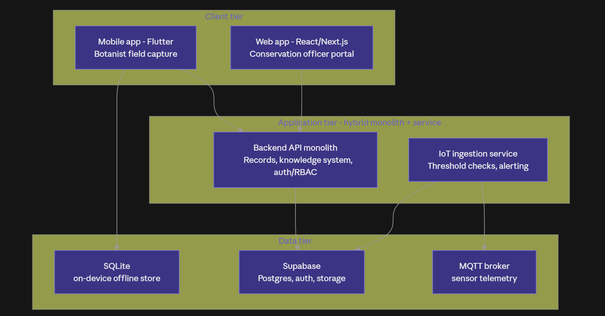
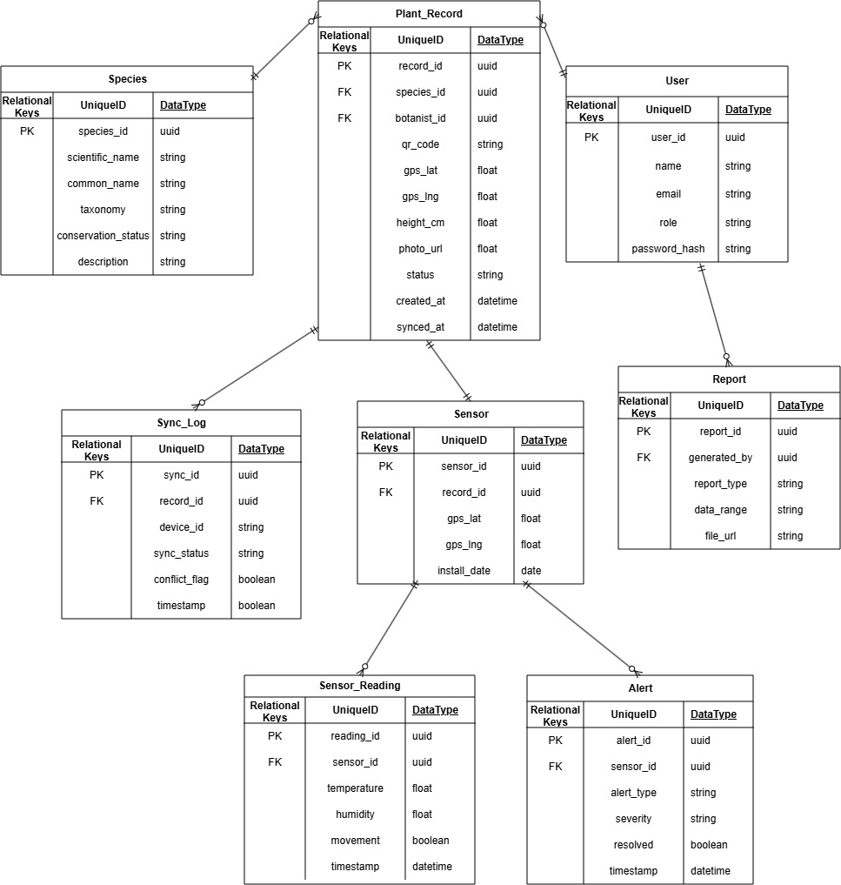
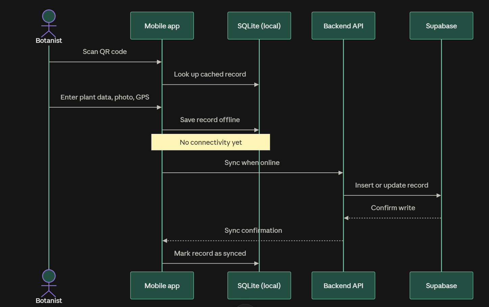
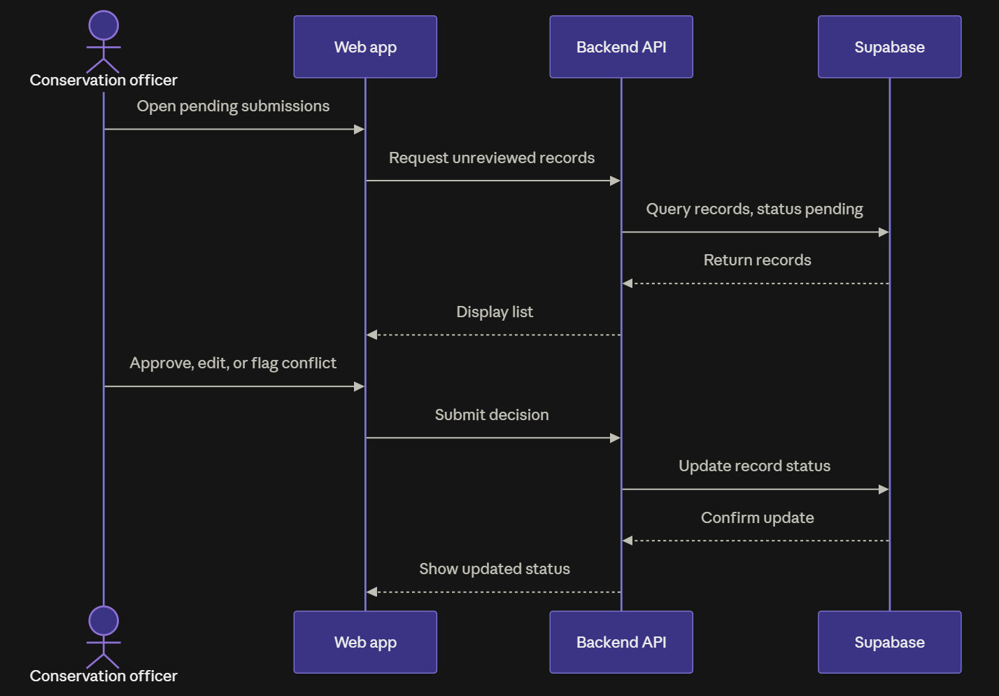
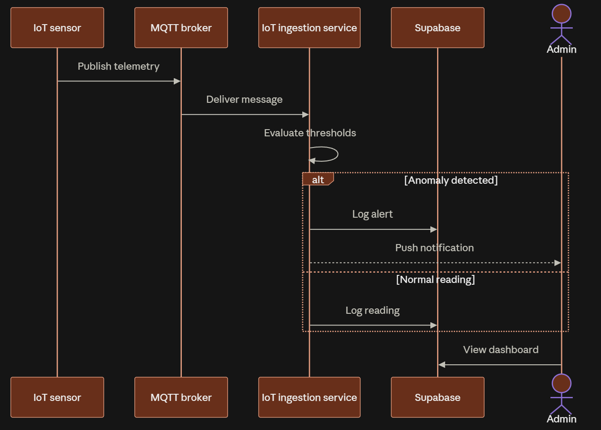

<p align="center">
  
</p>

<h1 align="center">Plantiful</h1>

<p align="center">
  <strong>Smart Ground-Truthing and Digital Biodiversity System for Plant Species Documentation</strong><br/>
  Niah National Park, Sarawak
</p>

---

## Overview

Plantiful is an integrated mobile and web platform that streamlines biodiversity documentation for Sarawak Forestry Corporation (SFC) at Niah National Park. Botanists scan QR-tagged plants and record species data offline in the field. Conservation officers review, approve, and publish that data through a centralised web knowledge system. An IoT monitoring layer records environmental conditions around monitored field sites and raises alerts that officers review in the web dashboard.

The platform can also run an optional AI Field Assist workflow. It requests plant-identification suggestions from Pl@ntNet or Kindwise, stores evidence privately, and keeps collector and officer decisions separate. AI suggestions never auto-approve a record and never auto-publish a species.

**Industry partner:** NeuonAI (SFC's commercialisation partner)

## Team (COS30049 Group 7)

| Name | Student ID | Role |
|---|---|---|
| Nathan Sebastian Learmonth | 102782258 | Web Knowledge System (Records) |
| Badrul Aliff Aiman bin Badrulmunirzaki | 102778273 | Web Knowledge System (Reporting & Maps) |
| Muhammad Maqeel bin Muhammad Kahfi | 102782384 | Mobile App (Sync & Backend APIs) |
| Ashley Wallen Anak Winston | 105806559 | Integration, PM & Documentation |
| Basill Agas Anak Heatley Rogers | 102778888 | Team Lead, Mobile App (Field Data Capture) |
| Gae Jayden MWINE | 104393610 | IoT-Based Plant Protection (sensor data pipeline, alert/threat detection logic, monitoring dashboard) |

## Tech Stack

| Layer | Technology |
|---|---|
| Mobile | Expo SDK 58 with React Native 0.88.1 (offline-first, QR, GPS, camera, SQLite) |
| Web | Next.js 16.4.6, React 19.2.8 and Tailwind CSS 4 |
| Backend and database | Supabase (PostgreSQL, auth, storage, auto-generated APIs) |
| Offline storage | SQLite on the device |
| IoT | ESP32 sensor node (DHT11/PIR/soil/rain) to USB bridge or Python simulator to threat-rule evaluator to Supabase (`sensors`, `sensor_readings`, `alerts`) to officer alert dashboard |
| AI Field Assist (optional) | Pl@ntNet or Kindwise through server-side adapters, private evidence archive and separate collector/officer decisions |
| Security testing | OWASP ZAP |
| Version control | Git and GitHub |
| Hosting | Vercel or Render with Supabase |

## System Architecture

<p align="center">
  
</p>

### ER Diagram

<p align="center">
  <br/>
  <em>ER diagram. Plantiful data model.</em>
</p>

### UML Sequence Diagrams

<p align="center">
  <br/>
  <strong>Botanist workflow</strong>
</p>

<p align="center">
  <br/>
  <strong>Conservation Officer workflow</strong>
</p>

<p align="center">
  <br/>
  <strong>Admin workflow</strong>
</p>

## Repository Structure

```text
COS30049_InnovationProject_Plantiful/
├── mobile/                # React Native / Expo app (offline field capture)
│   └── src/app/           # Expo Router screens (scan, capture, records, sync, profile)
├── web/                   # Next.js web knowledge system
│   ├── scripts/           # evaluation and maintenance scripts
│   └── src/app/           # App Router pages (explore, species, map, records, reports, alerts, profile)
├── backend/               # Supabase SQL and local checks (partly local-only)
│   ├── supabase/
│   │   ├── migrations/    # 001_schema.sql, apply_project.sql (002-011), 012-014
│   │   ├── seed.sql       # officer/admin roles and sample species
│   │   └── verification/  # manual SQL checks for RLS, photo writes and monitoring history
│   └── tests/local/       # pgTAP and isolated AI Field Assist checks
├── Ai/                    # research notebooks, datasets, training and evaluation workspace
├── iot/                   # ESP32 firmware, USB bridge, simulator and threat-rule evaluator
├── Docs/
│   ├── README.md          # documentation index and filing conventions
│   ├── Archive/           # historical notes and superseded material
│   ├── Assets/            # logo, diagrams and QR tag samples
│   ├── Design/            # design proposals and optional workflows
│   ├── Guides/            # deployment, maintenance and AI Field Assist guides
│   ├── Reports/           # shared reports, Sprint 1 and Sprint 2 folders
│   ├── Security/          # local-only security pack (gitignored)
│   ├── Templates/         # reusable docx and markdown templates
│   ├── Testing/           # historical verification records
│   └── Marking_Rubric.md  # assessment reference
├── .gitignore
└── README.md
```

`backend/supabase` and most local environment files are intentionally gitignored. A fresh clone may not contain the live database SQL or local environment examples. Ask the project owner for the current local backend bundle if you need to create a new Supabase project.

## Fresh Setup for a New User

### 1. Prerequisites

- Node.js 20.9 or newer and npm
- Python 3.10 or newer for the IoT scripts
- Expo Go on an Android or iOS phone, or an Android emulator
- Access to an existing Supabase project, or permission to create a new one

### 2. Clone and install

```powershell
git clone https://github.com/Basilagas21/COS30049_InnovationProject_Plantiful.git
cd COS30049_InnovationProject_Plantiful

cd web
npm ci
cd ..

cd mobile
npm ci
cd ..
```

If `npm ci` reports a stale lockfile, use `npm install` in that folder once and commit the updated lockfile if you are the project owner.

### 3. Create local environment files

These files are gitignored. Never commit them and never paste real keys into chat or issues.

Create `web/.env.local`:

```text
NEXT_PUBLIC_SUPABASE_URL=https://<project-ref>.supabase.co
NEXT_PUBLIC_SUPABASE_ANON_KEY=<anon-or-sb_publishable-key>

# Optional server-only settings for AI Field Assist
SUPABASE_SERVICE_ROLE_KEY=<service-role-or-sb_secret-key>
AI_PROVIDER=plantnet
PLANTNET_API_KEY=<plantnet-key>
# KINDWISE_API_KEY=<kindwise-key>
AI_PHOTO_BUCKET=record-photos
```

Create `mobile/.env`:

```text
EXPO_PUBLIC_SUPABASE_URL=https://<project-ref>.supabase.co
EXPO_PUBLIC_SUPABASE_ANON_KEY=<anon-or-sb_publishable-key>
EXPO_PUBLIC_SUPABASE_PHOTO_BUCKET=record-photos

# Optional, for AI Field Assist from a phone on the same network
EXPO_PUBLIC_FIELD_ASSIST_URL=http://<your-lan-ip>:3000
```

For IoT scripts, create `iot/.env` or export the variables in the terminal:

```text
SUPABASE_URL=https://<project-ref>.supabase.co
SUPABASE_SERVICE_ROLE_KEY=<service-role-or-sb_secret-key>
```

The IoT bridge loads `iot/.env` first, then falls back to `web/.env.local`. It also accepts values exported in the terminal. Shell values take precedence.

Use only public keys in `NEXT_PUBLIC_` and `EXPO_PUBLIC_` variables. The service-role key is server-only. Do not put it in the mobile app or any public-prefixed variable.

### 4. Choose a Supabase database

#### Option A: Join the existing project

This is the normal path for a teammate or marker.

1. Ask the project owner for the project URL, publishable/anon key, and test accounts.
2. Put the URL and public key in `web/.env.local` and `mobile/.env`.
3. Do not run migrations against the shared live project unless the owner asks you to.

#### Option B: Create a new Supabase project

1. Create a project in Supabase.
2. Enable email/password authentication.
3. Open Dashboard > SQL Editor and run the scripts in this order:
   - `backend/supabase/migrations/001_schema.sql`
   - `backend/supabase/migrations/apply_project.sql` (covers 002-011)
   - `backend/supabase/migrations/012_monitoring_history.sql`
   - `backend/supabase/migrations/013_field_assist.sql` (optional, only for AI Field Assist)
   - `backend/supabase/migrations/014_public_record_visibility.sql` (required for the public portal and raw REST visibility)
4. Edit the two email addresses in `backend/supabase/seed.sql`, then run it to assign officer/admin roles and add sample species.
5. Invite test users in Dashboard > Authentication > Users, or register through the app. If registration says "Email not confirmed", disable confirmation under Authentication > Emails or confirm the account manually.
6. Run the verification SQL in `backend/supabase/verification/`:
   - `verify_public_write_block.sql` should show anonymous writes rejected and anonymous reads limited to approved and published records.
   - `verify_record_photo_write.sql` should report `PASS` on every line before testing mobile sync.
   - `verify_alerts_history.sql` checks the monitoring history function.

### 5. Run the web app

```powershell
cd web
npm run dev
```

Open `http://localhost:3000`. Sign in with an officer or admin account to review records, approve submissions, publish species, and open the monitoring dashboard.

### 6. Run the mobile app

```powershell
cd mobile
npm start
```

Scan the QR code with Expo Go, or press `a` for an Android emulator. Run `npm run doctor` if Expo reports a dependency warning.

For AI Field Assist from a physical phone, set `EXPO_PUBLIC_FIELD_ASSIST_URL` to the computer's reachable LAN address and restart Expo. Do not use `localhost` on the phone.

### 7. Run the IoT monitor (optional)

Simulator, no hardware:

```powershell
python iot/publisher.py --once
python iot/evaluate.py
```

Real ESP32 node over USB:

```powershell
python -m pip install -r iot/requirements.txt
python iot/bridge.py --port COM5
```

Close Arduino Serial Monitor before running the bridge because only one process can own the COM port. The bridge reads `iot/.env` or `web/.env.local` automatically, so this one-line command is enough after the environment file exists.

Use the simulator only for demos. Do not run `iot/publisher.py` when you want only real node data, because it registers its own demo sensors and readings.

### 8. Verify the full loop

- A mobile capture appears as Pending in the web approvals page.
- An officer approves or rejects the record.
- An approved record becomes public only when its species is also published.
- Public pages show approved and published observations on `/records`, `/map`, `/species`, and `/explore`.
- The mobile app can sync offline records and photos.
- The IoT dashboard shows readings and alerts at `/alerts`.
- AI Field Assist history stays separate from the official species assignment.

## Common Issues

- **Missing web modules such as `lenis`:** run `npm ci` in `web`, remove `web/.next`, and restart `npm run dev`.
- **Phone cannot call the web backend:** use the computer's LAN IP in `EXPO_PUBLIC_FIELD_ASSIST_URL`, not `localhost` or `127.0.0.1`.
- **Registration says email not confirmed:** confirm the account in Supabase or disable email confirmation for the test project.
- **Approved record is not public:** confirm the species is published and migration `014_public_record_visibility.sql` has been applied.
- **IoT bridge says environment variables are missing:** create `iot/.env` or check the Supabase URL and service-role key in `web/.env.local`.
- **A key was exposed:** rotate it in Supabase Dashboard > Project Settings > API Keys, update the local environment file, and do not commit it.

## Checks

```powershell
cd web
npm run lint
npm run build
npm test

cd ../mobile
npx tsc --noEmit
npm run lint
npm test

cd ..
python -m unittest discover -s iot -p "test_*.py"
```

Optional end-to-end checks:

```powershell
cd web
npm run test:e2e
```

## Docs

- [Documentation index](Docs/README.md)
- [Sprint 2 plans, backlog and status](Docs/README.md#sprint-2)
- [Sprint 1 revised report and figures](Docs/README.md#sprint-1)
- [D-02 physical IoT wiring and editable diagram](Docs/README.md#d-02-physical-build)
- [AI Field Assist guide](Docs/Guides/AI_Field_Assist.md)
- [Prototype deployment and maintenance](Docs/Guides/Prototype_Deployment_and_Maintenance.md)
- [Additional Innovation testing](Docs/Testing/Additional_Innovation/README.md)
- [AI Field Assist verification record](Docs/Testing/Additional_Innovation/Verification.md)
- [Marking rubric](Docs/Marking_Rubric.md)
- [System Proposal Report](Docs/Reports/System_Proposal_Report.md)
- [Product Backlog Template](Docs/Templates/01_R_Product_Backlog_Template.md)
- [Project Proposal Template](Docs/Templates/COS30029%20Complete%20Project_Proposal_Template.md)
